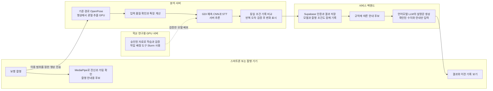

# GDI 중심 보행 분석 연구 중간발표 초안

작성일: 2026-11-01. 발표 대상은 프로젝트 지도교수와 협력기업 관계자다. 본문은 약 15~20분 발표를 위한 20장 구성이고, 세부 설정과 추가 실험은 뒤쪽 참고자료에 두었다. 발표 시간에 맞춰 참고자료를 본문에 모두 넣지는 않는다.

**발표의 중심:** 검사를 준비하고 반복하는 부담을 줄이기 위해 보행에서 상태 관련 정보를 얻고자 한다. 먼저 SPPB/TUG 예측으로 가능성과 한계를 살폈고, 현재는 실제 정답이 있는 GDI 예측과 직접 촬영한 모사 영상의 점수 차이를 근거로 GDI를 핵심 연구 대상으로 삼는다.

여기서 GDI는 **보행 편차 지수**, 즉 기준 보행과 움직임이 얼마나 다른지를 나타내는 값이다. 현재 출력은 영상으로 **예측한 GDI**다. 일반 고령자의 상태나 개인 변화를 평가하는 서비스는 앞으로 검증할 목표다.

## 1 걸어가는 모습만으로 상태를 자주 확인할 수 있을까

**화면에 넣을 내용**

보행영상에서 GDI를 추정하고, 상태와 변화를 살펴보기 위한 연구

`검사 자동 측정 → 보행 정보로 평가값 예측 → 실제 영상 적용 → 고령자·반복 측정 검증`

**발표 멘트**

저희가 만들고 싶은 것은 어르신이 걸어가는 모습을 촬영하면, 그 보행이 이전과 어떻게 다른지 살펴볼 수 있는 서비스입니다. 처음에는 사람이 하던 검사 측정을 AI가 대신하도록 만들고자 했습니다. 그런데 상태를 자주 확인하려면 측정뿐 아니라 검사를 준비하고 수행하는 부담도 줄여야 한다고 생각했습니다. 오늘은 이 문제에서 출발해 어떤 점수를 먼저 시험했고, 왜 지금 GDI를 중심에 두게 됐는지 설명드리겠습니다.

## 2 측정을 자동화해도 검사를 해야 한다는 부담은 남았다

**화면에 넣을 내용**

| 처음의 계획 | 다시 생각한 문제 |
|---|---|
| 카메라로 SPPB의 동작과 시간을 자동 측정 | 상태를 확인할 때마다 여러 동작을 준비해야 함 |
| 검사 결과 저장과 운동 안내 | 기관 검사 사이의 상태를 자주 알기 어려움 |

SPPB는 균형 유지·짧은 보행·의자 일어서기를 평가하는 신체기능 검사다.

**발표 멘트**

초기에는 스마트폰으로 균형 유지, 걷기, 의자 일어서기를 측정하는 SPPB 시스템을 구상했습니다. 시간을 재고 결과를 기록하는 수고는 줄일 수 있습니다. 하지만 대상자는 여전히 정해진 장소에서 여러 동작을 수행해야 합니다. 그래서 질문을 바꿨습니다. 검사할 때만 상태를 아는 것이 아니라, 평소에 가까운 간단한 보행 촬영에서도 상태와 관련된 정보를 얻을 수 있지 않을까 생각했습니다.

## 3 큰 문제를 두 단계로 나누었다

**화면에 넣을 내용**

```text
① 영상에서 움직임을 제대로 읽을 수 있는가?
   관절 위치·촬영 방향·시간·가림 확인
                  ↓
② 그 움직임으로 의미 있는 평가값을 얻을 수 있는가?
   실제 측정값을 정답으로 학습하고 새 사람에게 평가
                  ↓
두 단계가 연결돼야 상태 기록과 이전 결과 비교가 가능하다
```

**발표 멘트**

이 문제를 한 번에 해결하려 하지 않고 두 단계로 나눴습니다. 첫째는 영상에서 움직임을 믿을 수 있게 읽는 일입니다. 둘째는 그 움직임이 실제 평가 결과와 얼마나 연결되는지 확인하는 일입니다. 저희는 두 번째 질문을 먼저 시험했습니다. 보행으로 평가값을 예측할 가능성이 있는지 알아야, 첫 번째 단계에서 어떤 정보를 정확히 읽어야 하는지도 정할 수 있기 때문입니다.

## 4 먼저 정답이 연결된 보행 자료를 찾아야 했다

**화면에 넣을 내용**

필요한 자료: **같은 사람의 보행 + 실제 평가값 + 사람 구분 정보**

| 찾은 자료 | 바로 학습에 쓸 수 없는 이유 |
|---|---|
| 영상만 있는 자료 | 실제 평가값이 없음 |
| 점수와 3D 좌표가 있는 자료 | 영상 관절 추출까지 평가할 수는 없음 |
| 점수 이름만 있는 자료 | 표준 검사 총점과 같은 의미인지 확인 필요 |

**발표 멘트**

모델보다 먼저 해결해야 했던 문제는 정답이었습니다. 정상처럼 보인다고 임의로 높은 점수를 붙일 수는 없습니다. 실제 검사값이 같은 사람의 보행과 연결돼 있어야 합니다. 기업의 고령자 영상과 실제 평가값이 짝지어진 자료를 현재 실험에 쓰지 못하는 상황에서, 사용할 수 있는 공개자료를 조사했습니다. 자료마다 사람 번호와 점수를 연결하고, 같은 사람이 학습과 평가 양쪽에 들어가지 않도록 정리하는 작업부터 시작했습니다.

## 5 첫 시도는 보행으로 SPPB와 TUG를 예측하는 것이었다

**화면에 넣을 내용**

SPPB: 신체기능 총점. TUG: 의자에서 일어나 걷고 돌아와 앉는 데 걸린 시간.

MAE는 **실제값과 예측값이 얼마나 떨어졌는지 평균한 오차**이며 작을수록 좋다. 차이의 크기를 계산하므로 높게 예측한 오차와 낮게 예측한 오차가 서로 상쇄되지 않는다.

| 자료와 입력 | 예측한 정답 | 보행을 쓰지 않는 기준 | 보행을 쓴 결과 |
|---|---|---:|---:|
| 고령자 44명, 정밀 3D 보행 좌표 | 실제 SPPB 총점 | 1.318점 | **1.001점** |
| OpenCap 298명, 여러 카메라로 복원한 보행 정보 | 실제 TUG 시간 | 2.465초 | **2.058초** |
| Toronto 12명, 영상에서 추출한 관절 | 실제 TUG 시간 | 3.066초 | **2.473초** |

작은 글씨: 첫 행은 3초 구간 5개를 합친 결과다. 둘째 행은 3초 속도 요약과 RF(여러 결정나무의 판단을 합치는 예측모델)의 반복 평균이다. 셋째 행의 개선은 표본이 작아 불확실하다. 자료가 달라 행끼리 성능 순위를 매기지 않는다.

**발표 멘트**

정답이 있는 자료에서 가장 먼저 SPPB 총점과 TUG 시간을 예측했습니다. 여기서 기준은 보행을 보지 않고 학습 사람들의 대표값을 주는 방식입니다. 일부 자료에서는 보행을 사용했을 때 오차가 줄었습니다. 즉, 걸음에는 실제 기능평가와 연결되는 정보가 있다는 출발 근거를 얻었습니다. 다만 정밀 좌표와 여러 카메라로 복원한 정보도 사용했으므로, 이 수치를 스마트폰 한 대의 성능으로 설명하지는 않았습니다.

근거: [SPPB 44명](../../gdi-research-harness/studies/20261030-older44-sppb-timeseries/STATUS.md), [OpenCap 반복 비교](../../gdi-research-harness/studies/20261030-opencap415-speed-stability/STATUS.md), [Toronto TUG](../../gdi-research-harness/studies/20261030-tug-toronto-timeseries/STATUS.md).

## 6 가능성을 확인했지만 보행만으로 놓치는 부분도 있었다

**화면에 넣을 내용**

- SPPB에는 균형과 일어서기, TUG에는 기립·회전·착석이 포함된다.
- OpenCap에서는 많은 관절 정보보다 속도의 평균·변동·변화량을 쓴 모델이 더 낮은 오차를 보였다.
- TUG가 20초 이상인 9명에게는 전체 입력 RF도 평균 약 14초 짧게 예측했다.

**다음 질문: 걷는 움직임 자체에 더 직접 연결된 정답은 없을까?**

**발표 멘트**

이 실험을 통해 보행으로 기능평가를 추정할 가능성은 확인했습니다. 동시에 보행만으로는 놓치는 동작이 있다는 점도 알게 됐습니다. 전체 평균이 좋아도 수행이 느린 사람의 어려움을 작게 예측하는 문제가 남았습니다. 그래서 SPPB나 TUG를 포기하기보다, 보행의 움직임 자체를 평가하는 지표를 중심에 두고 기능평가와의 관계를 뒤에서 검증하는 방향을 생각했습니다. 그 지표가 GDI입니다.

## 7 GDI는 걷는 움직임의 차이를 나타내는 지표다

**화면에 넣을 내용**

**GDI, 보행 편차 지수:** 골반과 다리 관절의 움직임이 기준 보행에서 얼마나 달라지는지 요약한다.

| 현재 중심 질문 | 앞으로 확인할 질문 |
|---|---|
| 영상에서 실제 GDI를 얼마나 예측하는가? | 일반 고령자의 기능과 변화를 설명하는가? |
| 다른 보행 모양에 다른 점수를 주는가? | 같은 사람의 작은 변화를 재촬영 오차와 구분하는가? |

GDI는 건강 확률이나 SPPB 총점이 아니다. 정상처럼 보인다는 이유로 실제 GDI를 100점으로 정하지 않는다.

**발표 멘트**

GDI는 원래 정밀 장비로 얻은 관절 움직임을 기준 보행과 비교하는 지표입니다. 저희 모델은 그 GDI를 영상의 움직임 정보로 예측합니다. 보행 형태와 직접 연결된 정답을 사용할 수 있다는 점에서 현재 연구의 중심에 두기 적합하다고 판단했습니다. 다만 아동 자료로 학습한 점수를 일반 고령자의 건강 상태로 바로 해석할 수는 없습니다. 바로 그 적용 가능성을 앞으로 검증하려는 것입니다.

근거: [GDI 원 연구, Schwartz·Rozumalski 2008](https://doi.org/10.1016/j.gaitpost.2008.05.001). 고령자 적용의 선행 사례와 우리 연구의 차이는 참고자료 E에 정리했다.

## 8 두 선행연구에서 서로 다른 움직임 읽기 방식을 가져왔다

**화면에 넣을 내용**

| 선행연구 | 사용한 아이디어 | 우리 실험에서의 역할 |
|---|---|---|
| Kidziński 등, 2020 | CNN: 짧은 시간 동안 반복되는 움직임 패턴을 읽음. 여러 구간을 처리하고 평균 | 원 연구식 특징과 다구간 CNN의 출발점 |
| Le·Pham, ISBI 2024 | STT: 관절 사이 관계와 시간에 따른 관계에 비중을 두어 읽는 신경망 | 같은 자료에서 다른 방식의 예측을 비교 |

**발표 멘트**

첫 번째 연구는 영상에서 관절을 추출하고, 시간에 따른 움직임을 CNN으로 읽어 GDI를 예측했습니다. 두 번째는 어떤 관절과 시점에 주목할지를 학습하는 STT를 제안했습니다. 저희는 이 두 방식을 같은 사람과 같은 입력 구간에서 비교하고, 예측을 합치면 서로의 오류를 보완할 수 있는지 확인했습니다. 다구간 처리는 첫 번째 선행연구에도 이미 있던 방법이며, 이를 저희가 처음 제안했다고 주장하지 않습니다.

출처: [CNN 연구](https://pmc.ncbi.nlm.nih.gov/articles/PMC7426855/), [STT 연구](https://arxiv.org/abs/2312.00398), [CNN 공개 코드](https://github.com/stanfordnmbl/mobile-gaitlab), [STT 공개 코드](https://github.com/vinuni-vishc/transformer-gait-analysis).

## 9 사람과 정답을 연결한 뒤 학습자료를 구성했다

**화면에 넣을 내용**

```text
공개 보행 관절 좌표 + 검사별 실제 좌우 GDI
              ↓ 사람·검사 번호로 연결
입력 길이·결측·중복 확인
              ↓
692명 · 1,061기록 · 11,261개 겹치는 보행 구간
              ↓
같은 사람의 좌우·모든 방문·모든 구간을 같은 집단에 배치
```

**발표 멘트**

GDI 주 실험에는 공개된 2D 관절 좌표와 실제 GDI를 사용했습니다. 원자료는 뇌성마비 대상자 중심이며, 저희가 원본 RGB 영상을 전부 새로 분석한 자료는 아닙니다. 처음의 695명 조건에서 입력 검사상 세 명이 제외된 692명으로 이후 비교를 맞췄습니다. 한 사람의 반복 기록을 다른 사람처럼 취급하지 않았습니다. 구간은 만 개가 넘지만 독립된 참가자는 692명이라는 점을 유지했습니다.

## 10 관절 좌표를 그대로 넣기 전에 움직임을 비교할 준비를 했다

**화면에 넣을 내용**

| 처리 | 쉬운 설명 |
|---|---|
| 보간 | 잠깐 빠진 관절 위치를 주변 값으로 연결 |
| 평활화 | 프레임마다 생기는 작은 좌표 흔들림을 완화 |
| 정규화 | 몸의 위치와 크기 차이를 줄여 움직임을 비교 |
| 특징 계산 | 관절 좌표에 무릎·발목 각도와 발 사이 거리를 더함 |

CNN 입력: **124프레임 × 12개 특징**, 좌우 다리를 별도 예제로 처리한다.

**발표 멘트**

카메라와 사람의 위치가 다르면 같은 동작도 좌표가 달라집니다. 따라서 빠진 좌표를 연결하고 흔들림을 줄인 뒤, 골반 위치와 다리 길이를 기준으로 크기를 맞췄습니다. 여기에 관절 각도와 발 사이 거리처럼 움직임을 설명하는 값을 계산했습니다. 이 과정을 특성 엔지니어링, 즉 모델이 읽을 움직임 특징을 만드는 과정이라고 합니다. 다만 좌표를 정리했다고 관절 추출 오류까지 없어진 것은 아닙니다.

세부 입력·방향 처리·결측 기준은 참고자료 A에 있다. 전처리는 전체 기록을 활용하므로 124프레임만 촬영하면 같은 성능이 나온다고 해석하지 않는다.

## 11 같은 움직임을 두 방식으로 읽고 예측을 합쳤다

**화면에 넣을 내용**

```text
같은 보행 구간
   ├─ 좌표·각도·거리 → CNN → 구간별 GDI → 구간 평균·점수 보정
   └─ 관절 좌표     → STT → 구간별 GDI → 구간 평균·점수 보정
                                  ↓
                         두 모델의 예측 결합
                                  ↓
             양쪽 평균은 유지하고, 좌우 차이 예측을 보완
                                  ↓
                     여러 학습 모델을 함께 평균
```

**발표 멘트**

CNN은 짧은 움직임 패턴을 읽고, STT는 관절 사이와 시간 사이 관계를 읽습니다. 어느 한쪽이 항상 더 좋다고 정하지 않고 같은 자료에서 비교했습니다. 이후 두 예측을 섞고, 양쪽 평균 점수와 좌우 차이를 나누어 보완했습니다. 마지막에는 학습 때 만들어진 여러 모델의 예측을 평균했습니다. 평균은 두 종류입니다. 한 영상 안의 구간 평균과, 서로 다른 학습 모델의 평균을 구분했습니다.

## 12 처음 보는 사람에게도 통하는지 확인했다

**화면에 넣을 내용**

1. 사람을 다섯 집단으로 나누고 한 집단을 평가용으로 남긴다.
2. 나머지 사람 안에서 모델 설정·학습 길이·결합 비율을 정한다.
3. 남겨 둔 사람을 예측한다. 이 과정을 다섯 번 반복한다.
4. 파일·분할·계산식을 확인하고 저장 모델을 다시 실행해 결과를 대조한다.

**발표 멘트**

같은 사람의 다른 영상이 학습과 평가에 섞이면 사람을 기억한 효과가 성능처럼 보일 수 있습니다. 그래서 사람 단위로 나눴습니다. 모델을 어떻게 섞을지도 평가 대상자를 제외한 자료에서만 골랐습니다. 결과는 저장된 숫자만 읽지 않고, 파일 지문과 실제 재실행으로 확인했습니다. 다만 같은 개발자료를 여러 차례 살펴봤으므로, 새로운 독립 자료의 최종 성능과는 구분합니다.

## 13 한 구간 CNN에서 최종 결합까지 오차를 줄였다

**화면에 넣을 내용**

동일한 692명·1,061기록, 사람마다 같은 비중을 준 MAE다.

| 단계 | 실제 GDI와 평균 차이 MAE | 직전 단계 감소 |
|---|---:|---:|
| 원 연구식 특징·구조의 한 구간 CNN | 7.839점 | 기준 |
| 다구간 CNN | 6.867점 | 0.972점 |
| CNN + STT 예측 결합 | 6.687점 | 0.180점 |
| 좌우 차이 예측 결합 추가 | 6.606점 | 0.081점 |
| 학습 모델 평균 추가 | **6.516점** | **0.090점** |

**발표 멘트**

원 연구식 입력과 CNN 구조에 가깝게 맞춘 한 구간 모델은 평균 오차가 7.839점이었습니다. 다구간 방식으로 6.867점, 이후 결합을 거쳐 6.516점까지 줄였습니다. 한 구간부터는 총 1.323점, 약 16.9% 감소했습니다. 이미 다구간을 적용한 CNN부터 보면 추가 개선은 0.351점, 약 5.1%입니다. 다구간 도입에서는 학습량도 늘어났기 때문에, 구간 평균 하나만의 효과라고 단정하지 않습니다.

근거: [한 구간과 다구간 비교](../../gdi-research-harness/studies/20261030-gpu-motionbert-study/cnn-multiwindow695/analysis/comparison.json), [추가 결합 단계별 검산](../../gdi-research-harness/studies/20261030-gpu-motionbert-study/inner-bagging692/analysis/ablation-stanford-comparison.json).

## 14 복잡한 결합이 언제나 필요한 것은 아니었다

**화면에 넣을 내용**

| 비교 | MAE | 실제 GDI와 상관계수 |
|---|---:|---:|
| 우리 다구간 CNN | 6.867 | 0.715 |
| 우리 CNN 여러 모델만 평균 | 6.590 | 0.738 |
| 우리 최종 결합 | **6.516** | **0.744** |
| Stanford CNN 논문 보고치 | 6.50 | 0.750 |

상관계수는 실제 점수의 높고 낮음을 얼마나 함께 따라가는지 나타낸다. 0.744는 정확도 74.4%가 아니다.

**발표 멘트**

전체 결합의 개선은 확인했지만, 어떤 부분이 기여했는지도 따로 봤습니다. CNN 여러 개를 평균하는 것만으로도 6.590점까지 줄었습니다. 여기에 나머지 결합을 더한 0.075점의 차이는 아직 불확실합니다. 또 높은 실제 점수를 가진 사람들의 과소예측은 남아 있습니다. 스탠퍼드와는 수치상 가까워졌지만 평가 사람이 달라 더 우수하다고 말할 수 없습니다. 저희가 확인한 성과는 같은 자료 안에서의 개선과 그 개선을 나누어 검증한 과정입니다.

고득점·실패한 시도·비교의 불확실성은 참고자료 B·C에 있다. [Stanford 결과](https://pmc.ncbi.nlm.nih.gov/articles/PMC7426855/)

## 15 숫자 예측을 넘어 직접 촬영한 영상에도 적용해 보았다

**화면에 넣을 내용**

같은 사람이 정상 보행과 이상 움직임을 흉내 낸 영상 2개. 기존 모델·보정식을 고정하고 새 학습 없이 비교했다.

| 선택 구간 | 정상 | 이상 보행 모사 | 차이 |
|---|---:|---:|---:|
| 기존 자동 구간 | 75.41 | 64.59 | **+10.82점** |
| 점수 전에 고른 직선 구간 | 76.50 | 67.38 | **+9.12점** |

**발표 멘트**

공개 좌표에서의 성능만으로 끝내지 않고, 직접 촬영한 영상에도 적용했습니다. 같은 사람이 두 보행을 촬영했고, 모델이나 보정식을 그 영상에 맞춰 바꾸지 않았습니다. 기존 자동 구간과 별도로 정한 직선 구간에서 모두 정상 점수가 높았습니다. 다섯 분할 모델에서도 방향이 같았습니다. 실제 GDI 정답은 없으므로 점수 정확도를 확인한 결과는 아니지만, 이 영상 쌍의 움직임 차이에 기존 모델이 반응한다는 점을 확인했습니다.

촬영은 왕복·카메라 회전이 원 연구와 비슷했지만, 세로 화면과 비스듬한 시점·헐렁한 복장 등의 차이가 있었다. [모사 실험 통합 기록](../../gdi-research-harness/studies/20261101-self-video-gdi/EXPERIMENT_RECORD.md)

## 16 다른 촬영 영상 13개에서도 점수 차이가 나타났다

**화면에 넣을 내용**


| Test01 최종 라벨 | 영상 수 | 평균 | 영상 평균의 범위 |
|---|---:|---:|---:|
| 정상 | 6 | **79.35점** | 77.53~81.14 |
| 이상 보행 모사 | 7 | **66.68점** | 65.22~67.69 |

정상−모사 평균 차이 **12.67점**. 이번 묶음의 영상 평균 범위는 겹치지 않았다.

작은 글씨: 세 사람이 촬영한 13개 영상이다. 13명의 독립 검증이나 판별 정확도 100%를 뜻하지 않는다. 그림의 세로선은 영상 안 구간 점수 범위다.

**발표 멘트**

다음에는 Test01의 13개 영상을 같은 방식으로 처리했습니다. 사용자 라벨 기준으로 정상 영상은 평균 79.35점, 이상 보행 모사 영상은 66.68점이었습니다. 이번 묶음에서는 영상 평균 점수 범위가 겹치지 않았습니다. 다만 세 사람이 여러 움직임을 흉내 냈고, 일부 정상 라벨은 점수를 본 뒤 정정됐습니다. 따라서 이 결과는 다음 검증으로 진행할 근거로 사용하고, 일반 고령자를 정확하게 판별했다고 설명하지 않습니다.

번호별 점수와 라벨 변경 이력은 참고자료 D에 있다. [Test01 원 결과](../../gdi-research-harness/studies/20261101-self-video-test01/results.json)

## 17 이 근거를 바탕으로 GDI를 중심에 둔다

**화면에 넣을 내용**

| 확보한 근거 | 답할 수 있는 질문 |
|---|---|
| 실제 GDI가 있는 개발자료, 최종 MAE 6.516 | 실제 점수를 어느 정도 예측하는가? |
| 직접 촬영한 모사 영상의 점수 차이 | 이 영상의 다른 움직임에 반응하는가? |
| 남은 과제 | 일반 고령자와 개인 변화에도 의미가 있는가? |

**발표 멘트**

GDI를 중심에 두려는 이유는 이 두 종류의 근거를 확보했기 때문입니다. 하나는 실제 정답과 비교한 예측 성능이고, 다른 하나는 직접 찍은 영상에서 관찰한 점수 차이입니다. SPPB와 TUG 연구는 보행에 어떤 정보가 있는지 알게 해 준 출발점으로 남습니다. 이제는 GDI 예측을 핵심으로 다루고, 그 점수가 일반 고령자의 상태와 변화에도 유효한지 확인하려 합니다. 연구의 중심으로 선택한 것이지 고령자 평가가 완성됐다는 뜻은 아닙니다.

## 18 목표 시스템에서 각 AI는 어디서 작동하는가

**화면에 넣을 내용**

아래는 **서비스 설계안**이다. 현재 연구 경로와 아직 연결하지 않은 서비스를 구분한다.



**발표 멘트**

스마트폰은 촬영과 화면 안내를 담당하고, 분석 서버는 관절 추출과 GDI 예측을 담당하는 구성을 생각하고 있습니다. 저장과 권한 관리는 서비스 백엔드에서 처리합니다. 언어모델은 점수를 만들지 않고 확인된 결과를 쉽게 설명하는 역할입니다. 학교 GPU 서버는 연구용 학습 공간이며 실제 서비스 서버와 구분합니다. 현재는 로컬과 학교 서버에서 연구 처리를 확인한 상태이고, 촬영부터 앱 결과까지 전체 서비스 연결은 남아 있습니다.

경량화 후보: 같은 두 영상의 MediaPipe Full 비교에서도 정상−모사 차이가 유지됐다. 그러나 스마트폰 성능과 Test01 전체에서의 일치는 미확인이다. 따라서 현재 검증 경로인 OpenPose를 기준으로 두고, 기기에서 관절을 추출해 보내는 경로는 추가 검증 뒤 선택한다. 세부 배치와 현재 구현 범위는 참고자료 F에 있다.

## 19 GPU는 작은 실행으로 확인한 뒤 필요한 학습에 배정했다

**화면에 넣을 내용**

`입력·계산 검사 → 짧은 GPU 시험 → 본 학습 → 결과 회수 → 재계산·재실행 검산`

- 독립적인 사람 분할을 GPU 1개 작업 두 개로 나누어 병렬 처리한다.
- 작업 번호·진행 epoch·경과시간·메모리 기록으로 상태를 확인한다.
- 이미 계산한 관절과 예측을 재사용하고, 단순 결합 비교는 CPU로 수행한다.
- 담당 작업별 정기 확인과 완료 표시를 함께 확인해 중복 제출을 막는다.

**발표 멘트**

모든 비교를 새 GPU 학습으로 해결하지 않았습니다. 먼저 짧은 시험으로 입력과 계산이 맞는지 확인한 뒤 본 학습을 진행했습니다. 서로 독립인 분할은 GPU 한 개씩 쓰는 작업으로 나눠 처리했고, 단순 예측 결합은 저장된 결과로 CPU에서 계산했습니다. 진행 상황은 작업 관리 도구인 Slurm의 상태와 학습 로그를 함께 확인합니다. 작업이 끝났다는 표시만으로 성능 검증이 끝났다고 보지 않고 결과를 회수해 다시 계산했습니다.

실험별 정기 확인은 보통 30분이며 별도 지시가 있는 작업은 1시간이다. 작은 모델의 GPU 메모리 기록은 장치 전체 점유율과 구분한다. 실제 자원 관리 방식은 참고자료 G에 있다.

## 20 만들 서비스와 앞으로의 검증

**화면에 넣을 내용**

**목표 서비스:** 간단한 보행 촬영 → 분석 가능한지 확인 → GDI 예측과 보행 정보 기록 → 비교 가능한 이전 기록 확인 → 필요할 때 정식 평가 안내

| 검증 단계 | 확인할 내용 |
|---|---|
| 실제 점수 | 같은 사람의 영상 예측과 3D 장비 GDI가 얼마나 일치하는가? |
| 반복 촬영 | 상태가 같은 사람을 다시 찍을 때 얼마나 흔들리는가? |
| 고령자·실사용 | 연령·속도·복장·촬영 방향이 달라도 유효한가? |
| 기능과 변화 | SPPB/TUG와 어떤 관계이며 실제 변화에 반응하는가? |

**발표 멘트**

최종적으로는 기관 검사 사이에도 보행 기록을 쌓고 비교할 수 있는 서비스를 만들고자 합니다. 이를 위해 다음에는 실제 고령자의 영상과 같은 시점의 장비 GDI를 연결해야 합니다. SPPB와 TUG는 기능과의 관련성을 확인하는 별도 기준이며 GDI 정답을 대신하지 않습니다. 같은 상태를 다시 찍을 때의 오차를 먼저 알아야 작은 점수 차이를 변화라고 말할 수 있습니다. 검증이 진행되면 상태 확인의 준비 부담을 줄이고, 필요한 시점에 정식 평가로 이어 주는 역할을 기대하고 있습니다.

마무리 문장: **보행으로 상태를 알아볼 수 있는지에서 출발해, 실제 정답의 예측과 직접 촬영 영상의 차이를 확인했다. 이제 GDI를 중심으로 그 가능성이 일반 고령자와 개인 변화에도 이어지는지 검증하려 한다.**

검증 절차의 상세 내용은 참고자료 H에 있다. 개선 기준과 고령자 판정값은 수집·평가 계획을 확정한 뒤 정하며, 이번 모사 점수 사이에 임의의 정상·비정상 경계선을 만들지 않는다.

## 참고자료 A 데이터와 전처리의 상세 절차

### 자료를 고르는 순서

1. 이용 조건과 실제 제공 파일을 확인한다. 영상·좌표·센서를 구분한다.
2. 사람 번호와 검사 번호로 움직임과 실제 평가값을 연결한다. 반복 방문과 자료 간 중복을 확인한다.
3. 길이·결측·입력 정의가 맞는 기록을 고른다. 모델 결과가 좋다는 이유로 기록을 고르지 않는다.
4. 사람 단위로 학습·내부 확인·평가 역할을 나눈다. 입력 크기 조정과 보정식도 학습 사람만으로 계산한다.

| 실험 | 실제 입력 | 실제 정답 | 인원 해석 |
|---|---|---|---|
| 고령자 44명 | Vicon 장비의 3D 마커 좌표 | SPPB 총점 5~12점 | 220회 보행이지만 독립 총점은 44명 |
| OpenCap | 2~3대 RGB로 이미 복원된 관절 각도·골반 움직임 | 같은 방문 TUG 시간 | 3초 비교는 298명, 한 사람당 한 기록 |
| Toronto | AlphaPose 2D 관절 59구간 | 별도 임상표 TUG 9~25초 | 품질 조건을 통과한 12명 |
| GDI 주 실험 | 공개 OpenPose 2D 관절 좌표 | 검사별 실제 좌우 GDI | 692명·1,061기록, 반복 방문 포함 |
| 직접 촬영 | RGB 영상에서 새로 추출한 관절 | 정상·이상 보행 모사 라벨 | 실제 GDI와 독립 참가자 검증이 없음 |

SPPBdataset의 평가값 정의가 표준 SPPB 총점과 같은지 확정되지 않은 실험은 표준 총점 예측 성과에 포함하지 않았다. 센서 기반 Mobilise-D의 성과도 영상 성능과 구분했다.

### GDI 입력을 만드는 순서

```text
프레임별 BODY25 좌표와 사람 수 확인
    → 원 공개 코드에 맞춰 결측 연결·좌표 흔들림 완화
    → 골반 중심 이동·양쪽 허벅지 길이 평균으로 크기 조정
    → 왼쪽·오른쪽 각각 특징 계산
    → 124프레임 구간을 31프레임 간격으로 선택
    → 좌표 결측 25% 제한과 유한값 검사
    → 구간 예측 평균, 학습자료 한정 선형 보정
```

CNN의 12개 특징은 한쪽 다리의 엉덩이·무릎·발목·엄지발끝 x/y 좌표 8개, 무릎·발목의 화면상 각도 2개, 발끝−발목 거리와 양쪽 발목 거리 2개다. STT는 같은 구간의 좌표 8개를 `시간×4관절×xy`로 배열한다. 별도 좌우 결합 STT는 양쪽 8관절을 함께 처리한다.

공개 코드와 논문 설명의 방향 처리 차이를 기록했고, 현재 실험은 고정한 공개 코드 경로를 따랐다. 직접 촬영 영상에 사후 반전이나 좌우 교환을 추가하지 않았다. 공개 학습 좌표의 실제 FPS는 미확정이다. 30 FPS 영상의 124프레임이 약 4.1초라는 것과 학습 시간축 일치가 확인됐다는 것은 다르다.

다구간 학습에는 11,257개 구간과 앞부분 유효 구간이 없는 4기록의 기존 단일 구간, 총 11,261개를 사용했다. 이 대체 조건 때문에 원 논문의 전체 재현으로 부르지 않는다. 같은 기록에서 구간이 많다고 학습에 과도하게 반영되지 않도록 구간 수의 역수에 비례해 오차 비중을 조정했다.

근거: [CNN 입력·처리](../../gdi-research-harness/studies/20261030-gpu-motionbert-study/cnn-paper-input695/bundle/README.md), [다구간 조건](../../gdi-research-harness/studies/20261030-gpu-motionbert-study/cnn-multiwindow695/bundle/README.md).

## 참고자료 B 모델 설계와 학습 조건

| 구성 | 실제 설계 | 의도와 한계 |
|---|---|---|
| CNN | 1D 합성곱 6층, 필터 32개·길이 8. ReLU·BatchNorm, pooling·dropout 0.5, 작은 출력층. 학습으로 조정하는 숫자 47,840개 | 시간에 따라 반복되는 짧은 패턴을 읽는다. 입력 특징은 사람이 계산해 제공 |
| STT | 관절 관계 attention과 시간 관계 attention. 관절 하나를 12개 수로 표현하고 관계를 보는 갈래 2개 사용. 학습으로 조정하는 숫자 27,022개 | 어떤 관절과 시점의 관계를 볼지 학습한다. 좌표 8개를 사용 |
| 좌우 결합 STT | 양쪽 관절을 함께 입력 | 단독 전체 오차는 더 컸지만 좌우 차이 예측의 보완 가능성을 비교 |
| 모델 평균 | 각 평가 집단을 학습하지 않은 최종 모델과 내부 학습 모델의 예측 평균 | 동일한 평가 사람을 학습한 모델은 섞지 않음 |

합성곱은 짧은 시간 구간을 훑으며 패턴을 찾는 계산이다. ReLU는 양수 신호를 통과시키는 함수, BatchNorm은 층 출력의 크기를 정리하는 처리다. pooling은 시간 길이를 줄이고, dropout은 학습 중 일부 연결을 꺼 과도한 암기를 줄인다. attention은 여러 입력 중 어떤 관계에 비중을 둘지 학습하는 계산이다. 정규화·보정은 입력이나 예측값의 위치·크기를 맞추는 과정이고, 실제 정답을 새로 만들어 주는 과정은 아니다.

CNN은 RMSprop(가중치 조정 방식), 배치 32, 최대 100epoch를 사용했다. STT는 Adam, 배치 128, 최대 200epoch를 사용했다. epoch는 학습자료를 한 바퀴 사용하는 단위다. 두 모델의 계산량이 같도록 맞춘 비교는 아니다.

각 계열은 바깥 평가 5개에 대해 내부 확인 4개씩 총 20번, 이후 각 바깥 평가에 쓸 재학습 5번으로 구성했다. 학습 길이는 내부 사람들의 평균오차로 정했다. 결합 비율과 좌우 차이 비율도 평가 사람을 제외하고 선택했다. 보정식은 해당 모델의 학습 기록에서 구한 기울기와 절편을 사용했다.

최종 구성의 새 영상 추론에는 CNN 24개·STT 25개·좌우 결합 STT 5개, 총 54개 모델을 사용했다. 상수에 가까운 CNN 1개는 학습 예측의 표준편차에 관한 사전 규칙으로 제외했다. 모델 수를 사람 수로 세지 않는다.

### 어떤 요소가 얼마나 기여했는가

| 비교 | MAE 감소 | 사람별 오차를 다시 뽑아 계산한 95% 범위 |
|---|---:|---|
| CNN → CNN+STT | 0.180점 | 감소 0.084~0.281점 |
| CNN+STT → 좌우 차이 추가 | 0.081점 | 감소 0.042~0.122점 |
| 좌우 차이 구성 → 모델 평균 추가 | 0.090점 | 감소 0.024~0.156점 |
| 다구간 CNN → 최종 결합 | 0.351점·5.11% | 감소 0.226~0.478점 |
| 다구간 CNN → CNN 모델 평균만 | 0.276점·4.02% | 감소 0.175~0.382점 |
| CNN 모델 평균 → 최종 결합 | 0.075점·1.13% | 새−기존 −0.155~+0.006점, 0 포함 |

위 범위는 사람을 10,000회 재표집한 값이다. 저장된 개발 예측의 비교이며 모델 탐색 전체의 불확실성을 포함하지 않는다. 순서대로 추가한 비교이므로 각 요소의 모든 조합을 시험한 결과도 아니다. CNN 모델 평균 뒤에 STT·좌우 차이를 추가하는 이득은 독립 자료에서 다시 확인해야 한다.

최종 상관계수 0.743848의 사람 단위 재표집 95% 범위는 0.717688~0.768380이다. 한 사람의 여러 방문과 좌우를 각각 독립된 사람으로 재표집하지 않았다. MAE는 사람 동일 비중, 상관계수는 기록별 좌우 값을 통합한 값이다. 최종 결합의 기록·좌우 동일 비중 MAE는 6.472점이다.

근거: [STT 적용 조건](../../gdi-research-harness/studies/20261030-gpu-motionbert-study/stt692/bundle/README.md), [다구간 STT 설정](../../gdi-research-harness/studies/20261030-gpu-motionbert-study/stt692/multiwindow/bundle/protocol.json), [결합 검산](../../gdi-research-harness/studies/20261030-gpu-motionbert-study/inner-bagging692/analysis/ablation-stanford-comparison.json).

## 참고자료 C 지금까지 시도한 방법과 얻은 점

### 출발점이 다른 결과를 한 줄의 개선으로 합치지 않는다

| 단계 | 확인한 결과 | 해석 |
|---|---|---|
| 초기 695명, 17관절 좌표·신뢰도를 넣은 자체 CNN | MAE 8.683 | 이후 원 연구식 12개 특징 CNN과 입력·구조가 달라 별도 출발점 |
| 고정 MotionBERT 특징의 회귀 비교, 695명 | Ridge 8.527, PLS 7.975, 시간 특징 결합 7.619 | 3D 움직임 모델이 뽑은 특징과 간단한 점수 모델을 비교한 경로 |
| 원 연구식 특징·좌우 별도 CNN, 692명 | 한 구간 7.839 → 다구간 6.867 | 이후 결합 비교의 기준 CNN |
| 같은 다구간 STT | 6.945 | CNN보다 단독 오차는 컸지만 예측 결합을 시험할 근거가 됨 |
| CNN·STT 예측 결합 | 6.687 | 같은 자료에서 오류를 일부 보완 |
| 좌우 결합 STT 단독 | 7.004 | 단독으로는 악화. 차이 부분만 보완한 구성은 6.606 |
| CNN·STT 내부 모델 평균까지 사용 | 6.516 | 현재 이 발표의 기준 최선. 독립 최종 검증은 남음 |

MotionBERT는 영상 관절에서 3D 움직임 표현을 얻는 모델이다. Ridge·PLS는 그 특징을 실제 점수와 연결하는 회귀 방법이다. 위 695명 결과와 692명 결과의 차이를 한 가지 모델 변경의 효과로 계산하지 않는다.

### 개선되지 않았거나 추가 이득이 제한된 시도

| 시도 | 관찰 | 다음 판단에 반영한 점 |
|---|---|---|
| 고득점 자료의 학습 비중 확대 | 전체와 고득점 구간을 함께 개선하지 못함 | 점수 분포를 강조하는 것만으로 해결되지 않음 |
| 좌우 결합 STT | 전체 평균 예측과 좌우 차이 예측의 장단점이 다름 | 전체 점수를 교체하기보다 평균과 차이를 나누어 비교 |
| 움직임 사전학습 STT | 6.960으로 기존 STT 6.945보다 개선되지 않음 | 다른 학습을 추가했다는 사실만으로 효과를 주장하지 않음 |
| 기록 평균을 학습 손실에 직접 반영 | 7.324로 같은 실험 대조군 7.251보다 개선되지 않음 | 학습 방식 변경과 단순 예측 평균을 구분 |
| Balanced MSE, 드문 점수의 영향 보정 | 같은 실험 MSE 6.922, BMC 6.945 | 기존 최선 6.516을 교체할 근거 없음 |
| RankSim, 가까운 정답끼리 표현을 가깝게 학습 | 같은 실험 MSE 6.922 → RankSim 6.782 | 해당 대조군보다 개선됐지만 기존 최선보다 낮은 오차는 아님 |
| 점수 구간을 직접 예측하는 모델 | 기존 최선 점수 모델을 교체할 정도의 이득을 확인하지 못함 | 넓은 점수 구간의 높은 적중률을 연속 점수 정확도 개선으로 설명하지 않음 |

BMC·RankSim에서는 원 보정계수의 엄격 일치 검사가 실패한 사례를 보존하고, 원 환경 및 별도 출력 재계산 검산과 구분해 보고했다. 실패 기록을 삭제하거나 기준을 낮춰 통과시킨 결과로 서술하지 않는다. 현재 진행 중인 다른 학습의 결과는 이 표에 포함하지 않았다.

### 외부 영상과 점수대에서 확인한 한계

실제 사람 평균 GDI 90 이상인 68명의 MAE는 다구간 CNN 8.294점, 최종 결합 8.783점이었다. 전체 평균은 좋아졌지만 높은 실제 점수를 낮게 예측하는 문제는 해결하지 못했다. 이 68명 기준은 ‘좌우 관측값 중 90 이상인 사람’과 다르다.

외부 GAVD 영상에서는 조건을 맞춘 두 쌍의 정상−비정상 차이가 평균 +2.06점이었지만 한 CNN 모델에서는 방향이 뒤집혔다. 학습 방향과 같은 정상 측면 표본도 확보하지 못했다. 따라서 어떤 외부 영상에서도 정상·비정상을 안정되게 가린다고 설명하지 않는다. 직접 촬영 모사 실험의 더 큰 차이 역시 촬영 조건과 움직임 구성의 영향을 분리해 확인해야 한다.

근거: [초기 CNN](../../gdi-research-harness/studies/20261030-gpu-motionbert-study/cnn-followup695/report.md), [시도별 현황](../../gdi-research-harness/studies/20261030-gpu-motionbert-study/STATUS.md), [고득점 분석을 포함한 단계별 계산](../../gdi-research-harness/studies/20261030-gpu-motionbert-study/inner-bagging692/analysis/ablation-stanford-comparison.json), [GAVD 외부 영상](../../gdi-research-harness/studies/20261031-gavd-cnn/README.md).

## 참고자료 D 직접 촬영 모사 실험의 전체 결과

### Test01 번호별 점수

| 번호 | 최종 사용자 라벨 | 예측값 |
|---:|---|---:|
| 1 | 정상 | 79.94 |
| 2 | 정상 | 79.62 |
| 3 | 정상 | 81.14 |
| 4 | 이상 보행 모사 | 66.96 |
| 5 | 이상 보행 모사 | 67.26 |
| 6 | 정상 | 77.53 |
| 7 | 이상 보행 모사 | 67.04 |
| 8 | 정상 | 79.10 |
| 9 | 정상 | 78.79 |
| 10 | 이상 보행 모사 | 65.22 |
| 11 | 이상 보행 모사 | 66.38 |
| 12 | 이상 보행 모사 | 67.69 |
| 13 | 이상 보행 모사 | 66.24 |

정상 6개 평균은 79.351065점, 모사 7개 평균은 66.683320점이다. 두 평균의 차이는 12.667746점이고, 가장 낮은 정상과 가장 높은 모사의 차이는 9.837176점이다. 이것은 실제 GDI 차이가 아니라 모델 예측값의 차이다.

사용자는 세 사람이 여러 움직임을 흉내 냈다고 설명했고, 사람별 짝맞춤 없이 영상별로 보고하라고 요청했다. 이 분석 요청을 13명의 독립 표본이라는 뜻으로 해석하지 않는다. 모든 영상의 예측값과 모델은 정정 전후 같다.

### 촬영과 처리에서 달랐던 조건

원 연구와 마찬가지로 왕복 보행과 카메라 회전이 있지만 이번에는 세로 영상이고 순수 측면 외의 시점이 섞인다. 거리와 보행로 길이는 실측하지 않았고 헐렁한 복장에 의한 가림도 있다. 원 프레임 순서를 유지하고, 필수 좌표의 결측 25% 제한도 유지했다.

공식 OpenPose에서도 신뢰도가 1을 조금 넘는 값이 재현됐다. 사용자 승인 아래 별도 어댑터에서 그 상한 검사만 예외 처리했다. 좌표·신뢰도를 잘라내지 않았고 다른 입력 제한과 모델을 유지했다. 이 예외를 감춘 채 원래 입력 검사 전체를 그대로 통과했다고 말하지 않는다.

1차 2개 영상은 2,382프레임, Test01은 6,634프레임이었다. 원본·모델 지문, 구간과 프레임 대응, 특징 재계산, 기존 모델 재현과 별도 결합식 계산을 확인했다. 구간 수·모델 수는 참가자 수가 아니다. 이 모사 영상의 실제 GDI가 없으므로 MAE·임상 판정 경계·중증도 순서를 계산하지 않았다.

### MediaPipe를 사용한 보조 비교

같은 사람의 1차 두 영상에만 MediaPipe Full을 적용했다. 기존 자동 구간의 정상−모사 차이는 OpenPose +10.82점, MediaPipe +10.81점이었고, 직선 구간에서는 +9.12점·+9.27점이었다.

같은 노트북 CPU의 같은 50프레임에서 관절 반환까지의 속도는 OpenPose 약 1.99 FPS, MediaPipe Full 약 57.34 FPS였다. 두 구현의 스레드 설정과 처리 단계가 다르고 초기화·파일 읽기·저장은 제외했다. 스마트폰의 속도·발열·배터리 결과가 아니다.

MediaPipe의 발끝 지점은 OpenPose 엄지발끝과 근사 대응이고, 절대 점수도 약 1.2~1.5점 이동했다. 이 두 영상에서 차이의 방향을 유지한 것이므로 OpenPose와 완전히 호환된다고 확정하지 않는다. 자연어로 움직임을 설명하는 모델을 이 영상에 추가 결합한 실험도 아니다.

근거: [모사 실험 통합 기록](../../gdi-research-harness/studies/20261101-self-video-gdi/EXPERIMENT_RECORD.md), [MediaPipe 비교](../../gdi-research-harness/studies/20261101-self-video-mediapipe/README.md).

## 참고자료 E 선행연구와 연구 기여의 범위

### 세 연구는 서로 다른 질문에 답한다

| 연구 | 질문 | 이번 연구와의 관계 |
|---|---|---|
| Schwartz·Rozumalski 2008 | 정밀 관절 움직임의 차이를 어떻게 한 지표로 나타낼까? | GDI 지표 자체의 출처 |
| Kidziński 등 2020 | 단일 영상의 관절로 장비 GDI를 예측할 수 있을까? | CNN·다구간·구간 평균·선형 보정의 출처 |
| Le·Pham 2024 | 관절과 시간 관계를 함께 읽으면 보행 지표를 예측할 수 있을까? | STT 구조의 출처 |

스탠퍼드의 GDI 상관계수 0.75·MAE 6.5는 CNN 중심 처리의 최종 보고치다. 랜덤포레스트와 릿지회귀는 비교 모델이었다. 별도 수술 예측에서 CNN과 실제 장비 GDI를 쓰는 로지스틱회귀를 결합한 결과를 GDI 예측의 앙상블 결과로 혼동하지 않는다.

우리 구현은 공개 코드의 입력·구조를 참고하되 사람 분할, 학습 길이 선택, 일부 대체 구간과 실행 환경이 다르다. 원 논문의 완전 재현이나 스탠퍼드 대비 성능 우위라고 주장하지 않는다. 우리 성과는 동일 개발자료에서 예측 결합의 추가 효과와 한계를 나누어 확인하고, 실제 촬영 입력으로 이어서 시험한 것이다.

### 노인과 영상 GDI의 선행 사례도 있다

- Liu 등 2023은 노인 34명의 세 가지 속도 보행을 3D 장비로 측정해 GDI를 분석했다. 공개 초록에서 질환 제외 기준까지 확인한 것은 아니다. [학술지 자료](https://tjty.cbpt.cnki.net/portal/journal/portal/client/paper/ca22ab6fc39dd20fa0b3202c26221925)
- Gao 등 2026은 전노쇠 고령자 68명을 배정한 12주 운동 연구에서 3D 보행분석의 GDI를 결과 지표로 사용했다. 완전히 건강한 집단과는 구분한다. [논문](https://link.springer.com/article/10.1186/s12984-026-02057-9)
- Peiffer 등 2026의 PBL은 스마트폰 영상에서 3D 움직임을 복원한 뒤 GDI를 계산하고 여러 임상 집단에서 반복성과 변화 반응을 평가했다. [논문](https://pmc.ncbi.nlm.nih.gov/articles/PMC13562619/)
- 스탠퍼드 기술 소개에도 노인의 일반적인 기능 저하 관찰이 활용 방향으로 명시돼 있다. 실제 일반 고령자 검증과 응용 가능성의 제안은 구분한다. [공식 소개](https://techfinder.stanford.edu/technology/automated-gait-analysis-using-video)

따라서 ‘노인에게 GDI를 처음 사용했다’거나 ‘영상에서 GDI를 처음 얻었다’고 주장하지 않는다. **기존 모델을 일반 고령자에게 적용할 때 무엇이 유효하고 어떤 조건에서 실패하는지, 개인 변화까지 관찰할 수 있는지를 검증하는 방향**으로 기여를 구체화한다.

## 참고자료 F 서비스 구성과 각 AI의 작동 위치

| 위치 | 역할 | 현재 상태와 다음 연결 |
|---|---|---|
| 스마트폰·태블릿의 웹 앱 | 촬영, 전신·가림·길이 안내, 결과 화면 | 기존 검사 화면 기반을 활용할 설계안. MediaPipe 기기 실행과 GDI 연결은 별도 확인 필요 |
| 관절 추출 서버 | 기준 경로 OpenPose로 BODY25 관절 추출 | 로컬·학교 연구 서버에서 실제 영상 추론 확인. 운영 서버의 응답시간·동시처리는 미검증 |
| 점수 분석 서버 | 특징 생성, CNN/STT 예측, 기존 결합, 입력 실패 처리 | 연구용 실행 확인. PyTorch 추론을 CPU 또는 GPU에 배치할 수 있으나 서비스 지연시간을 보고 결정 |
| Supabase 백엔드 | 인증·권한·검사 및 결과 저장 | 기존 대상자·검사 저장 코드 기반이 있음. GDI 결과 저장과 전체 경로는 연결 전 |
| 안내 규칙과 서버 LLM | 검사 필요 안내와 이해하기 쉬운 결과 설명 | 설계안. LLM은 GDI를 계산하거나 정상·비정상 경계를 만들지 않음 |
| 학교 연구 GPU 서버 | 승인된 학습·비교·검산과 모델 버전 관리 | 연구 실행 장소. 학교 서버를 상시 운영 서비스 서버로 확정한 것은 아님 |

이용자는 처음에는 옆모습 전신이 잘 보이는 안내 촬영을 수행한다. 품질이 부족하면 점수를 억지로 내지 않고 재촬영 이유를 알린다. 결과에는 연구용 GDI 예측값, 촬영 조건과 모델 버전을 함께 남긴다. 이전 기록 비교는 추출기·모델·촬영 조건의 차이와 반복오차가 확인된 범위에서 제공한다. 임의의 일상 장면을 아무 방향에서나 바로 판정하는 기능은 후속 확장 목표다.

기존 SPPB 검사는 실제 기능평가를 남기는 별도 경로로 유지한다. 운동 안내는 기존에 확인한 검사 결과와 운동 규칙을 기반으로 설계하고, GDI 숫자 하나만으로 운동 처방을 결정하는 규칙을 이번 초안에서 추가하지 않는다. LLM에는 확인된 수치와 허용한 안내를 전달해 설명을 생성하며, 원본 영상을 설명 API에 보내는 흐름으로 설계하지 않는다.

MediaPipe의 기기 내 관절 추출이 검증되면 원영상 대신 관절을 서버로 보내는 경로도 검토할 수 있다. 그러나 그때는 관절 정의·발끝 대응·실제 시간축·점수 이동을 다시 확인해야 한다. 화면 촬영 안내용 MediaPipe와 GDI 입력용 OpenPose를 같은 추출기로 표시하지 않는다.

현재 기존 웹·서버 코드가 있다는 것과 새 보행 서비스가 끝까지 연결돼 있다는 것은 다르다. 이번 변경은 발표와 실험 기록이며 앱·서버 연결·데이터베이스·모델 배포를 변경한 작업이 아니다.

## 참고자료 G GPU 자원 사용과 진행 관리

### 계산을 줄이는 방식

| 운영 방식 | 목적 | 적용 범위 |
|---|---|---|
| 관절·특징·예측을 파일 지문과 함께 재사용 | 같은 전처리나 추론의 중복 계산을 줄임 | 단순 모델 결합·통계는 CPU에서 수행 |
| 작은 실제 시험 후 본 학습 | 입력 오류와 실행 불일치를 일찍 발견 | 예: 3epoch 시험, 저장·다시 읽기·GPU/CPU 출력 확인 |
| 독립 분할을 GPU 1개 작업 두 개로 분담 | 순차 실행할 계산을 동시에 진행 | 같은 자료·분할·학습 조건 유지. 한 모델을 GPU 두 개로 분산 학습한 것은 아님 |
| 분할별 실행 잠금과 별도 출력 폴더 | 중복 학습과 결과 덮어쓰기 방지 | 완성된 다섯 분할을 한 번만 집계 |
| 학습 길이를 내부 평가에서 선택 | 평가 정답으로 학습 횟수를 맞추지 않음 | CNN 최대 100, STT 최대 200epoch |

자원은 Slurm이 배정한 GPU에서만 사용한다. 저장 기록상 해당 계정에서 GPU 2개를 한 작업에 요청했을 때 자원 제한 대기가 발생해 GPU 1개 작업 두 개로 나눈 이력이 있다. 작업별 보이는 장치 번호가 같더라도 실제 GPU UUID(장치 고유번호)를 확인해 같은 물리 장치인지 구분한다. 분할 수·대기·입출력이 달라 정확히 두 배 빨라졌다고 주장하지 않는다.

### 무엇을 확인하는가

- Slurm의 대기·실행·종료 상태와 종료코드를 확인한다.
- 학습 로그의 완료 학습 수, 현재 epoch, 경과시간과 손실·평가 오차를 확인한다.
- 시험 실행에서 epoch 시간과 PyTorch 최대 할당·예약 메모리를 기록한다. 이는 CUDA 실행 환경을 포함한 GPU 전체 메모리·활용률과 다르다.
- 담당 실험별 등록부에 작업 번호·출력 위치·검산 상태를 연결한다. 보통 30분 정기 확인을 사용하며 사용자 지시에 따라 1시간인 실험도 있다.
- 중간 작업 하나가 끝난 것을 실험 전체 완료로 처리하지 않는다. 완료 표시와 기대 모델 수, 회수한 파일 지문, 수치 재계산과 저장 모델 재추론까지 확인한다.

실행 중인 다른 실험이나 다른 담당 채팅의 작업은 변경하지 않는다. 본 발표를 위해 새 학습·예약·자원 할당을 시작하지 않았다. 작은 보고서와 검산은 C 작업본, 큰 자료와 모델·캐시는 D에 보존한다.

근거: [GPU 운영 기록](../../docs/guides/GPU_USAGE.md), [다구간 CNN 실행 검산](../../gdi-research-harness/studies/20261030-gpu-motionbert-study/cnn-multiwindow695/analysis/verification.json).

## 참고자료 H 지표를 검증하고 서비스로 연결하는 순서

아래는 앞으로 사용할 검증 설계안이다. 대상 수와 성공 기준, 영상 이용 범위는 자료 수집 전에 정한다. 현재 모사 점수에서 사후로 경계값을 고르지 않는다.

### 1단계 실제 GDI를 정답으로 확보한다

일반 고령자의 보행을 촬영하면서 가능한 같은 보행 시행의 3D 장비 관절 움직임을 얻고, 정해진 계산법으로 GDI를 만든다. 영상·장비 결과·좌우·검사 시점을 연결한다. 영상만 있거나 SPPB/TUG만 있으면 GDI 정확도 평가의 정답이 생기는 것은 아니다.

처음에는 기존 모델이 학습한 GDI 정의와 참조집단을 고정해 예측값과 비교한다. 정상 참조집단 자체를 고령자로 바꾸는 것은 새 점수 정의에 관한 별도 연구다. 노인 영상을 입력하는 것과 노인 기준 GDI로 재정의하는 것을 구분한다.

### 2단계 처음 보는 사람의 점수가 맞는지 평가한다

모델 개발용 사람과 최종 평가용 사람을 먼저 나눈다. 같은 사람의 반복 영상은 한쪽에만 둔다. CNN 모델 평균과 전체 결합을 비교해 복잡한 결합이 필요한지도 확인한다. MAE, 상관계수, 높거나 낮게 예측하는 경향과 실제값−예측값 차이의 분포를 함께 본다. 평균이 비슷하다는 이유만으로 개인별 점수가 맞는다고 판단하지 않는다.

건강한 고령자와 기능 저하가 있는 대상의 분포를 함께 살펴 정상적인 연령 차이·속도 차이와 기능 저하를 구분할 수 있는지 확인한다. 원자료에서 높은 GDI를 낮게 예측하는 문제도 우선 점검한다.

### 3단계 같은 상태를 다시 찍어 오차를 알아낸다

같은 날 반복 촬영과 다른 날의 안정 상태 촬영을 구분해 수집한다. 촬영 위치·각도·의복·걸음 속도를 기록한다. 반복값이 얼마나 일관되는지와 점수의 흔들림을 계산한다. 이후 이 흔들림을 넘어서는 차이부터 개인 변화로 볼 수 있는지 판단한다. 모델 다섯 개의 점수 차이나 영상 속 겹치는 구간의 차이를 재촬영 오차로 대신하지 않는다.

### 4단계 촬영 조건이 바뀌어도 유지되는지 본다

우선 측면 안내 촬영 조건을 고정하고 거리·가림·기기 등을 한 번에 하나씩 바꿔 본다. 앞·뒤 촬영은 기존 측면 모델의 입력 조건과 달라 별도 적용 검증을 한다. OpenPose와 MediaPipe의 관절 대응과 점수 이동도 같은 사람의 대응 자료로 비교한다. 입력이 부적합한 영상은 실패율과 이유까지 보고한다.

### 5단계 기능과 실제 변화의 관계를 확인한다

같은 시점의 SPPB/TUG를 별도로 측정해 GDI 예측이 어떤 기능 차이를 설명하는지 확인한다. 속도만으로도 설명되는 부분을 넘어 추가 정보가 있는지 비교한다. 나이·성별·속도의 차이를 함께 살피고, 단순 관계를 임상 판정 정확도로 바꾸어 표현하지 않는다.

현재 개발자료의 반복 검사 229명·581쌍에 대해서는 예측 GDI의 차이를 실제 GDI 차이와 비교한 탐색이 있다. 사람별 변화량 오차는 모델 7.570점, 변화 없음 기준 8.941점이고 방향 일치는 69.07%였다. 그러나 정확한 날짜와 안정 상태 재촬영 오차, 임상적 개선 여부가 없어 고령자 변화 감지를 검증한 결과로 쓰지 않는다. [반복 검사 탐색](../../gdi-research-harness/studies/20261101-gdi-longitudinal-audit/STATUS.md)

### 6단계 서비스의 실제 부담도 확인한다

촬영 성공률, 준비·촬영·분석 대기시간, 반복 촬영 필요 횟수와 안내 이해도를 확인한다. 조건이 맞지 않을 때 재촬영 안내가 작동하는지, 결과가 서로 다른 버전·추출기에서 만들어졌을 때 무조건 비교하지 않는지도 확인한다. 이를 통해 반복 관찰이 편해진다는 기대효과가 실제 이용에서도 나타나는지 평가한다.

## 발표에서 사용할 결과의 범위

- **현재 성과:** 공개자료의 실제 평가값 예측, 같은 개발자료의 GDI 개선, 직접 촬영 모사 영상의 점수 차이, 두 영상의 관절 추출기 비교.
- **현재 핵심 연구:** 일반 고령자를 위한 보행 분석의 주 지표 후보로 GDI를 두고 예측 정확도와 적용 조건을 검증한다.
- **목표 서비스:** 조건을 확인한 보행 촬영으로 연구용 예측값과 기록을 제공하고, 검증이 쌓인 뒤 비교 가능한 개인 변화와 정식 평가 안내로 연결한다.

이번 결과는 일반 고령자 임상 검증, 질환 진단, 정상·비정상 정확도 100%, 새로운 GDI 척도의 최초 제안을 뜻하지 않는다. 모사 실험 기록과 원 결과는 그대로 보존하며, 향후 기준을 미리 정한 새로운 사람·촬영 조건의 검증으로 이어 간다.
