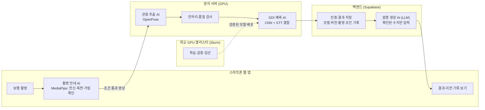

# 중간발표 2 슬라이드 초안 — 걷는 모습으로 상태를 읽는 GDI 연구

작성일: 2026-11-01 · 발표: 2026-11-02 중간발표 2 · 분량: 본문 24장(약 18분) + 부록

같은 날 작성된 [GDI 중심 중간발표 초안](2026-11-01-gdi-centered-interim-draft.md)과 같은 실험 기록을 근거로 하되, **이야기 흐름과 독자성 전달**에 맞춰 장면을 다시 구성한 판이다. 수치는 모두 저장된 실험·검산 기록에서 가져왔고, 각 장 끝에 근거를 연결했다.

## 발표 전체를 관통하는 한 줄

> **검사를 자동화하려다 '검사를 해야 하는 부담'이 진짜 문제라는 것을 알았다. 보행만으로 상태를 읽을 수 있는지 SPPB·TUG로 먼저 시험했고, 그 한계에서 보행 자체를 측정하는 정답인 GDI를 찾았다. 이제 아동 자료로 만든 GDI 예측이 일반 고령자의 상태와 변화까지 읽을 수 있는지 검증한다.**

```text
문제 발견 ─→ 첫 시도(SPPB·TUG) ─→ 배운 점 ─→ GDI 전환 ─→ 방법·결과 ─→ 실촬영 확인 ─→ 시스템·서비스 ─→ 검증 계획
 1~4장        5~7장              7장        8~9장      10~17장     18~19장       20~22장         23~24장
```

| 파트 | 장 | 시간 |
|---|---|---:|
| Ⅰ 문제와 목표 | 1~4 | 3분 |
| Ⅱ 첫 시도: SPPB·TUG | 5~7 | 2.5분 |
| Ⅲ GDI로의 전환과 독자성 | 8~9 | 2분 |
| Ⅳ 방법: 데이터·전처리·모델·평가 | 10~14 | 4분 |
| Ⅴ 결과: 시도 이력·성능·실촬영 | 15~19 | 4분 |
| Ⅵ 시스템·GPU·서비스·검증 | 20~24 | 3분 |

---

# Ⅰ. 문제와 목표

## 1. 상태가 변하는 순간은 검사 날이 아니다

**화면**

- 큰 문장: **"고령자의 기능 저하는 서서히 진행되지만, 확인은 가끔 하는 검사에서만 이루어진다."**
- 아래에 시간축 그림: `검사 ●──────(모르는 구간)──────● 검사`

**발표 멘트**

어르신의 신체기능은 하루아침에 떨어지지 않습니다. 조금씩 걸음이 느려지고, 보폭이 줄고, 좌우가 달라집니다. 그런데 이 변화를 확인하는 방법은 대개 기관에서 하는 신체기능 검사입니다. 검사와 검사 사이에 무슨 일이 일어나는지는 알기 어렵습니다. 저희 프로젝트는 이 '모르는 구간'을 줄이고 싶다는 생각에서 출발했습니다.

## 2. 측정을 자동화해도, 검사를 해야 하는 부담은 남았다

**화면**

| 처음 계획 | 다시 본 문제 |
|---|---|
| 스마트폰으로 SPPB(균형·보행·의자 일어서기) 시간을 자동 측정 | 공간·의자·보조 인력을 준비하고, 정해진 동작을 순서대로 해야 함 |
| 결과 저장, 운동 안내 | 기관 밖에서 자주 반복하기 어려움 |

하단 강조: **바꾼 질문 — "검사를 대신 재 주는 AI"에서 "검사 없이 걷는 모습만으로 상태를 읽는 AI"로**

**발표 멘트**

처음에는 SPPB 검사를 카메라로 자동 측정하는 시스템을 구상하고, 측정·기록 화면의 초안까지 만들었습니다. 그런데 만들면서 한계가 보였습니다. 카메라가 시간을 대신 재 줘도, 어르신은 여전히 검사 공간에서 정해진 동작을 해야 합니다. 그래서 질문을 바꿨습니다. 검사를 대신 재 주는 것이 아니라, 평소처럼 걷는 모습만 찍어도 상태를 알 수 있다면 어떨까. 이것이 지금 연구의 출발점입니다.

## 3. 큰 질문을 검증 가능한 두 질문으로 나눴다

**화면**

```text
"걷는 모습만으로 상태를 알 수 있을까?"
            │
   ┌────────┴─────────┐
 질문 A                질문 B
 영상에서 움직임을      그 움직임이 실제 평가값과
 제대로 읽을 수 있나?   연결되는가?
 (관절 추출·촬영 조건)  (정답이 있는 자료로 학습·평가)
            │
  먼저 B를 시험 → 무엇을 정확히 읽어야 하는지가 정해짐 → A로 연결
```

**발표 멘트**

이 질문은 한 번에 풀기에는 너무 큽니다. 그래서 두 개로 나눴습니다. A는 영상에서 관절 움직임을 믿을 수 있게 읽는 문제이고, B는 그 움직임이 실제 평가 결과와 연결되는지의 문제입니다. 저희는 B를 먼저 시험했습니다. 움직임이 평가값을 설명한다는 근거가 없으면, 영상 처리를 아무리 다듬어도 의미가 없기 때문입니다.

## 4. 연구 목표와 기대효과

**화면**

**연구 목표**

1. 단일 측면 보행영상에서 **GDI(보행 편차 지수)를 예측하는 모델**을 만들고, 실제 장비 측정값과 비교해 정확도를 확인한다.
2. 이 모델이 **일반 고령자의 보행 차이와 시간에 따른 변화**를 읽을 수 있는지 검증한다.
3. 촬영 → 품질 확인 → 점수 → 기록 비교로 이어지는 **보행 기록 서비스**로 연결한다.

**기대효과**

| 대상 | 기대효과 |
|---|---|
| 어르신·보호자 | 검사 준비 없이 짧은 보행 촬영으로 상태 기록을 쌓음 |
| 기관·협력기업 | 정기 검사 사이의 변화를 추적하고, 필요한 시점에 정식 평가로 연결 |
| 연구 측면 | 아동 임상자료로 만든 지표가 고령자에게 어디까지 통하는지에 대한 근거 |

**발표 멘트**

연구 목표는 세 가지입니다. 영상으로 GDI를 예측하는 모델을 만들고, 그 모델이 일반 고령자에게도 통하는지 검증하고, 마지막으로 이를 실제로 쓸 수 있는 서비스로 연결하는 것입니다. 기대효과는 검사를 대체하는 것이 아니라, 검사와 검사 사이를 채워 주는 것입니다. 변화가 보이면 그때 정식 평가로 연결하는 역할을 생각하고 있습니다.

---

# Ⅱ. 첫 시도: 보행으로 SPPB·TUG를 예측하다

## 5. 모델보다 먼저, '정답'이 연결된 자료가 필요했다

**화면**

필요한 조건: **같은 사람의 보행 + 실제 평가값 + 사람 구분 정보 + 이용 조건**

| 조사한 자료 유형 | 바로 쓸 수 없던 이유 |
|---|---|
| 영상만 있는 자료 | 정답(평가값)이 없음 |
| 점수 + 정밀 3D 좌표 자료 | 영상 관절 추출 단계는 평가할 수 없음 |
| 점수 이름만 같은 자료 | 표준 검사 총점과 같은 정의인지 불명확 |

하단: 기업 영상은 IRB·이용 범위 문제로 현재 실험에 사용하지 못함 → **공개자료에서 답할 수 있는 질문부터 구분해 진행**

**발표 멘트**

AI가 점수를 예측하려면 정답이 필요합니다. 정상처럼 보인다고 임의로 높은 점수를 줄 수는 없습니다. 그런데 보행과 실제 평가값이 같은 사람으로 연결된 자료는 생각보다 드물었습니다. 영상은 있는데 점수가 없거나, 점수는 있는데 영상이 없었습니다. 기업 자료도 승인 문제로 아직 쓸 수 없었습니다. 그래서 공개자료를 하나씩 확인해 사람과 정답을 연결하고, 같은 사람이 학습과 평가에 동시에 들어가지 않도록 정리하는 일부터 했습니다.

## 6. 보행에는 기능평가와 연결된 신호가 있었다

**화면**

MAE: 실제값과 예측값 차이의 평균. **작을수록 좋다.** 기준선은 보행을 보지 않고 학습자 대표값만 내는 방법이다.

| 자료 | 입력 | 정답 | 기준선 | 보행 모델 |
|---|---|---|---:|---:|
| 고령자 44명 | 정밀 3D 보행 좌표, 3초×5구간 | SPPB 총점(5~12점) | 1.318점 | **1.001점** |
| OpenCap 298명 | 여러 카메라로 복원한 3초 보행 | TUG 시간 | 2.465초 | **2.058초** |
| Toronto 12명 | 영상에서 추출한 2D 관절 | TUG 시간 | 3.066초 | **2.473초** |

작은 글씨: 자료마다 입력·정답이 달라 행끼리 순위를 매기지 않는다. Toronto는 12명이라 기준선 대비 개선이 불확실하다.

**발표 멘트**

정답이 있는 자료에서 SPPB 총점과 TUG 시간을 예측했습니다. 세 자료 모두에서, 보행을 본 모델이 보행을 보지 않은 기준선보다 오차가 작았습니다. 걷는 모습에 기능평가와 연결된 정보가 있다는 첫 근거입니다. 다만 고령자 44명은 정밀 장비 좌표, OpenCap은 여러 카메라로 복원한 정보라서, 스마트폰 한 대의 성능이라고 말하지는 않습니다.

근거: [SPPB 44명](../../gdi-research-harness/studies/20261030-older44-sppb-timeseries/STATUS.md) · [OpenCap 반복 비교](../../gdi-research-harness/studies/20261030-opencap415-speed-stability/STATUS.md) · [Toronto TUG](../../gdi-research-harness/studies/20261030-tug-toronto-timeseries/STATUS.md)

## 7. 그러나 보행만으로는 검사 전체를 대신할 수 없었다 — 여기서 얻은 것

**화면**

| 관찰 | 의미 |
|---|---|
| TUG 20초 이상인 9명을 평균 약 14초 **짧게** 예측 | 상태가 나쁜 사람일수록 놓친다 |
| 회전 동작을 추가하면 2.114초 → 1.118초 | 정확해지지만, 결국 '검사 동작'을 다시 요구하게 됨 |
| 많은 관절 정보보다 속도 요약 3개가 더 좋음 | 정답(TUG)이 걷기보다 넓은 동작을 담고 있음 |

큰 결론: **SPPB·TUG에는 균형·기립·회전이 섞여 있다 → "걷는 움직임 자체"를 측정한 정답이 필요하다**

**발표 멘트**

동시에 한계도 분명했습니다. TUG가 오래 걸리는, 즉 상태가 좋지 않은 사람일수록 크게 짧게 예측했습니다. 회전 동작을 넣으면 오차가 거의 절반으로 줄었지만, 그건 결국 어르신께 다시 검사 동작을 요구하는 방향입니다. 저희가 처음 피하려던 부담으로 돌아가는 셈입니다. 여기서 중요한 교훈을 얻었습니다. SPPB와 TUG에는 걷기 외의 동작이 섞여 있어서, 보행 영상만으로 맞추기에는 정답이 너무 넓었습니다. 그래서 걷는 움직임 자체를 측정한 정답을 찾았고, 그것이 GDI입니다.

근거: OpenCap 과소예측은 위 OpenCap 기록, 회전 추가 비교는 [10-31 원고 10장](2026-10-31-interim-presentation.md)의 238명 비교.

---

# Ⅲ. GDI로의 전환

## 8. 왜 GDI를 중심에 두는가

**화면**

**GDI(Gait Deviation Index, 보행 편차 지수):** 골반·엉덩이·무릎·발목의 움직임이 일반적인 보행에서 얼마나 벗어났는지를 하나의 수로 요약한다. 100이 일반 보행 평균이고, 10점 낮을 때마다 표준편차 1만큼 멀어진다. (Schwartz·Rozumalski, 2008)

| 기준 | SPPB·TUG | GDI |
|---|---|---|
| 정답이 측정하는 것 | 균형·기립·회전·보행 혼합 | **보행 움직임 자체** |
| 확보한 정답 규모 | 44명 / 298명 / 12명 | **692명 · 1,061기록** |
| 점수 형태 | 정수 총점 또는 시간 | 연속값, **좌·우 다리 각각** |
| 선행 비교 기준 | 영상 기반 공개 기준 부족 | 영상 예측 선행연구(MAE 6.5) 존재 |
| 실촬영 반응 | 미확인 | 직접 촬영 영상에서 점수 차이 확인(18장) |

하단: GDI는 건강 확률이나 SPPB 점수가 아니다. **보행 모양의 차이**를 나타낸다.

**발표 멘트**

GDI를 선택한 이유는 다섯 가지입니다. 첫째, 정답이 보행 그 자체를 측정합니다. 둘째, 정답이 있는 자료가 692명으로 SPPB·TUG 자료보다 훨씬 많습니다. 셋째, 연속 점수이고 좌우 다리를 따로 줘서 작은 차이와 비대칭을 볼 수 있습니다. 넷째, 영상으로 GDI를 예측한 선행연구가 있어 우리 성능을 객관적으로 비교할 수 있습니다. 다섯째, 뒤에서 보여드릴 직접 촬영 영상에서도 점수가 반응했습니다. 다만 GDI는 보행 모양을 나타내는 지표이지, 건강 상태 그 자체는 아닙니다. 이 점이 바로 저희가 검증하려는 부분입니다.

## 9. 선행연구에서 출발했지만, 같은 질문을 풀지 않는다

**화면**

| | 선행연구 | 우리 연구 |
|---|---|---|
| GDI 지표 (Schwartz 2008) | 3D 장비로 보행 편차를 계산 | 장비 GDI를 정답으로 사용 |
| 영상 GDI 예측 (Kidziński 2020, Stanford) | 뇌성마비 아동(평균 11세) 영상 → **1D-CNN 하나** | **CNN + STT 두 방식 결합**, 좌우 평균·차이 분리, 모델 평균 → **요소별 기여를 분해해 검증** |
| 관절·시간 관계 모델 (Le·Pham 2024, STT) | 보행 지표 예측용 신경망 제안 | CNN의 오류를 보완하는 **두 번째 시각**으로 결합 |
| 고령자 활용 | Stanford 기술 소개에 '노인 기능 저하' **응용 가능성 제안** | 그 가능성을 **검증 가능한 질문으로 바꿔 실제로 시험** |

하단 강조: **우리의 질문 — "아동 임상자료로 학습한 영상 GDI 모델이, 일반 고령자의 상태 차이와 시간에 따른 변화까지 읽을 수 있는가?"**

**발표 멘트**

이 분야에는 중요한 선행연구가 있습니다. 스탠퍼드 연구는 아동 보행영상에서 CNN 하나로 GDI를 예측했고, 노인 기능 저하에도 쓸 수 있을 것이라고 제안했습니다. 하지만 제안만 했을 뿐, 고령자에게 실제로 통하는지는 검증하지 않았습니다. 저희는 두 가지에서 다릅니다. 방법에서는 서로 다른 방식으로 움직임을 읽는 두 모델을 결합하고, 각 요소가 실제로 얼마나 기여했는지 하나씩 분해해 확인했습니다. 질문에서는 '노인에게도 쓸 수 있다'는 가능성을, 일반 고령자의 상태와 변화를 읽는지 검증하는 연구로 바꿨습니다. 저희가 처음으로 노인에게 GDI를 썼다거나, 처음으로 영상에서 GDI를 얻었다고 주장하지 않습니다. 그 대신 이 적용이 어디까지 유효한지 밝히는 것을 저희 기여로 둡니다.

출처: [Kidziński 등 2020](https://pmc.ncbi.nlm.nih.gov/articles/PMC7426855/) · [Le·Pham 2024](https://arxiv.org/abs/2312.00398) · [Schwartz·Rozumalski 2008](https://doi.org/10.1016/j.gaitpost.2008.05.001) · [Stanford 기술 소개](https://techfinder.stanford.edu/technology/automated-gait-analysis-using-video) · 그 밖의 고령자 GDI 사례는 부록 C

---

# Ⅳ. 연구 방법

## 10. 전체 처리 과정 한눈에 보기

**화면**

```text
측면 보행영상
   ↓ ① 관절 추출 (OpenPose, 25개 신체 지점)
프레임별 2D 관절 좌표
   ↓ ② 전처리 (결측 보간 · 흔들림 완화 · 위치·크기 정규화)
   ↓ ③ 특성 계산 (좌표 + 무릎·발목 각도 + 발 사이 거리)
124프레임(약 4초) 구간 여러 개
   ↓ ④ 두 모델이 각 구간을 예측
   ├─ 1D-CNN : 짧은 시간 패턴을 읽음
   └─ STT    : 관절 사이·시간 사이 관계를 읽음
   ↓ ⑤ 구간 평균 → 점수 보정 → 두 모델 결합 → 좌우 차이 보완 → 모델 평균
좌·우 GDI 예측값
```

**발표 멘트**

전체 흐름입니다. 영상에서 관절을 뽑고, 정리하고, 움직임 특징을 계산한 뒤, 약 4초 단위 구간을 두 모델이 각각 읽습니다. 마지막으로 여러 구간과 여러 모델의 예측을 모아 좌우 다리 각각의 GDI를 냅니다. 이제 각 단계를 하나씩 설명드리겠습니다.

## 11. 데이터 구성 — 692명을 '사람 단위'로 나눴다

**화면**

```text
공개 2D 관절 좌표(OpenPose) + 검사별 실제 좌우 GDI(3D 장비 측정)
              ↓ 사람·검사 번호로 연결
길이·결측·중복 확인 (입력 조건 미달 3명 제외)
              ↓
692명 · 1,061기록 · 11,261개 보행 구간
              ↓
한 사람의 좌우·모든 방문·모든 구간 → 반드시 같은 집단
```

| 수 | 의미 |
|---|---|
| 692명 | 독립된 사람 수 (평가의 기본 단위) |
| 1,061기록 | 반복 방문 포함 (229명은 2회 이상 방문) |
| 11,261구간 | 학습 예제 수. **사람 수로 세지 않음** |

**발표 멘트**

GDI 실험에는 공개된 관절 좌표와 실제 장비 GDI를 썼습니다. 원 자료는 뇌성마비 대상자 중심입니다. 구간은 만 개가 넘지만, 독립된 사람은 692명입니다. 같은 사람의 다른 영상이 학습과 평가에 나뉘어 들어가면 AI가 그 사람을 기억해서 점수가 좋아 보일 수 있습니다. 그래서 한 사람의 모든 기록을 항상 같은 쪽에 두었습니다.

근거: [다구간 입력 조건](../../gdi-research-harness/studies/20261030-gpu-motionbert-study/cnn-multiwindow695/bundle/README.md)

## 12. 전처리와 특성 엔지니어링 — 카메라 차이를 지우고 움직임만 남긴다

**화면**

| 단계 | 하는 일 | 왜 필요한가 |
|---|---|---|
| 보간 | 잠깐 빠진 관절을 앞뒤 값으로 연결 | 가림·인식 실패로 생긴 빈칸 |
| 평활화 | 프레임마다 떨리는 좌표를 완화 | 관절 추출기의 미세한 흔들림 |
| 정규화 | 골반 중심으로 옮기고 허벅지 길이로 크기 맞춤 | 카메라 거리·키 차이 제거 |
| 특성 계산 | 엉덩이·무릎·발목·발끝 x/y(8) + 무릎·발목 각도(2) + 발끝–발목·양 발목 거리(2) | 좌표만으로는 드러나기 어려운 '움직임의 모양' |
| 구간화 | 124프레임 구간을 31프레임 간격으로 겹쳐 추출 | 한 영상에서 여러 번 관찰 |
| 품질 검사 | 필수 좌표 결측 25% 넘는 구간 제외 | 나쁜 입력으로 점수를 만들지 않음 |

CNN 입력: **124프레임 × 12개 특성**, 좌·우 다리를 각각 별도 예제로 처리

**발표 멘트**

같은 걸음이라도 카메라에서 멀면 작게, 가까우면 크게 찍힙니다. 그래서 골반을 기준점으로 옮기고 다리 길이로 크기를 맞춰, 카메라 차이가 아닌 움직임만 남게 했습니다. 여기에 무릎·발목 각도와 발 사이 거리를 계산해 넣었습니다. 이렇게 모델이 읽기 좋은 움직임 특징을 만드는 과정이 특성 엔지니어링입니다. 또 결측이 많은 구간은 점수를 억지로 내지 않고 제외합니다. 이 원칙은 나중에 서비스에서 '재촬영 안내'로 이어집니다.

근거: [CNN 입력·처리](../../gdi-research-harness/studies/20261030-gpu-motionbert-study/cnn-paper-input695/bundle/README.md)

## 13. 모델 설계 — 두 개의 눈으로 같은 걸음을 본다

**화면**

| 구성 | 구조 | 읽는 것 | 크기 |
|---|---|---|---:|
| 1D-CNN | 합성곱 6층(필터 32·길이 8), BatchNorm, Dropout 0.5 | 시간에 따라 반복되는 짧은 패턴 | 47,840개 가중치 |
| STT | 관절 관계 attention + 시간 관계 attention | 어떤 관절·시점의 관계가 중요한지 | 27,022개 가중치 |
| 좌우 결합 STT | 양쪽 다리 8개 관절을 함께 입력 | 좌우 차이 | — |

결합 방식:

```text
CNN 예측 ─┐
          ├─ 결합 비율로 혼합 → 좌우 평균은 유지, 좌우 차이는 좌우 결합 STT로 보완
STT 예측 ─┘                                   ↓
                          서로 다르게 학습된 여러 모델의 예측 평균 (최종 54개 모델)
```

결합 비율·좌우 차이 비율은 **평가 대상자를 뺀 자료 안에서만** 정했다.

**발표 멘트**

모델은 두 종류입니다. CNN은 걸음 속 짧은 리듬을 잘 읽고, STT는 어떤 관절과 어떤 순간의 관계가 중요한지를 스스로 학습합니다. 서로 다른 방식으로 보기 때문에 틀리는 지점도 다를 것이라고 생각했습니다. 그래서 두 예측을 섞었고, 양쪽 다리의 평균 점수와 좌우 차이를 나눠서 보완했습니다. 마지막으로 학습 중에 만들어진 여러 모델의 예측을 평균했습니다. 모델이 수만 개의 가중치로 작기 때문에, 54개를 함께 써도 추론 부담이 크지 않습니다.

근거: [STT 적용 조건](../../gdi-research-harness/studies/20261030-gpu-motionbert-study/stt692/bundle/README.md) · 학습 조건 상세는 부록 A

## 14. 평가 설계 — 처음 보는 사람에게도 통하는지 확인한다

**화면**

```text
692명 → 5개 집단으로 분할
  ├─ 1개 집단: 평가용 (끝까지 손대지 않음)
  └─ 4개 집단: 학습용
        └─ 그 안에서 다시 나눠 학습 길이·결합 비율을 선택
→ 평가 집단을 바꿔 5번 반복 → 692명 전원이 한 번씩 '처음 보는 사람'으로 평가됨
```

검산: 파일 지문(SHA-256) 대조 · 두 가지 계산식으로 MAE·상관계수 재계산 · 저장 모델 재실행 결과 대조

**발표 멘트**

평가에서 가장 신경 쓴 것은 'AI가 정답을 미리 보지 않게 하는 것'입니다. 평가할 사람은 학습뿐 아니라 설정을 고르는 데에도 쓰지 않았습니다. 이걸 다섯 번 반복해서 모든 사람이 한 번씩 처음 보는 사람으로 평가되게 했습니다. 결과는 저장된 숫자만 믿지 않고, 파일 지문과 모델 재실행으로 다시 확인했습니다.

---

# Ⅴ. 결과

## 15. 여기까지 오기까지 — 시도와 방향 수정의 기록

**화면**

```text
① 큰 사전학습 모델(MotionBERT) 특징 + 회귀        8.527 → 7.975 → 7.619  (695명)
      └ 배운 점: 큰 모델보다 '정보를 어떻게 쓰느냐'가 중요
② 원 연구 방식 재구현: 12개 특성 + 1D-CNN, 한 구간   7.839  (692명, 이후 기준)
③ 같은 CNN에 여러 구간 학습·평균                     6.867
④ STT 결합 → 좌우 차이 보완 → 모델 평균              6.516  ← 현재 최선
```

| 시도했지만 채택하지 않은 방법 | 결과 | 남긴 교훈 |
|---|---|---|
| 움직임 사전학습 STT | 6.960 (기존 STT 6.945) | 학습을 더 얹는다고 좋아지지 않음 |
| 드문 점수 보정(Balanced MSE·RankSim) | 대조군보다 일부 개선, 최선 6.516은 못 넘음 | 고득점 문제는 손실 함수만으로 해결 안 됨 |
| 고득점 자료 비중 확대 | 전체·고득점 동시 개선 실패 | 분포 강조만으론 부족 |

**발표 멘트**

이 성능은 한 번에 나온 것이 아닙니다. 처음에는 큰 사전학습 모델의 특징을 썼는데, 생각보다 이득이 작았습니다. 그래서 방향을 바꿔 선행연구의 입력과 CNN을 직접 구현해 기준을 세웠고, 여기서부터 여러 구간 활용과 모델 결합으로 오차를 줄였습니다. 효과가 없었던 시도도 그대로 기록했습니다. 사전학습을 추가하거나 손실 함수를 바꾸는 것만으로는 기존 최선을 넘지 못했습니다. 이 실패들 덕분에 무엇이 실제로 효과가 있는지 가려낼 수 있었습니다.

작은 글씨: ①(695명)과 ②~④(692명)는 입력·조건이 달라 한 줄의 개선량으로 합치지 않는다.

근거: [시도별 현황](../../gdi-research-harness/studies/20261030-gpu-motionbert-study/STATUS.md)

## 16. 선행연구식 CNN 대비 오차를 16.9% 줄였다

**화면**

같은 692명·1,061기록, 사람마다 같은 비중의 MAE

| 단계 | MAE | 직전 대비 |
|---|---:|---:|
| 원 연구식 한 구간 CNN | 7.839 | 기준 |
| + 여러 구간 학습·평균 | 6.867 | −0.972 |
| + STT 예측 결합 | 6.687 | −0.180 |
| + 좌우 차이 보완 | 6.606 | −0.081 |
| + 여러 학습 모델 평균 | **6.516** | −0.090 |

| 비교 | MAE | 실제 GDI와 상관계수 |
|---|---:|---:|
| **우리 최종** | **6.52** | **0.744** (95% 구간 0.718~0.768) |
| Stanford 논문 보고치 | 6.50 | 0.75 (0.68~0.81) |

상관계수 0.744: 실제 점수가 높은 사람을 높게 예측하는 경향이 강하다는 뜻. **정확도 74%라는 뜻이 아니다.**

**발표 멘트**

같은 자료, 같은 평가 방식에서 원 연구식 CNN의 오차는 7.839점이었고, 최종 결합에서는 6.516점으로 16.9% 줄었습니다. 다구간을 적용한 CNN부터 봐도 결합으로 0.35점, 약 5% 더 줄었고, 다섯 평가 집단 모두에서 개선됐습니다. 실제 GDI와의 상관계수는 0.744로 스탠퍼드 보고치 0.75와 비슷한 수준입니다. 평가 대상자가 달라 우열을 말할 수는 없지만, 선행연구 수준의 예측력을 확보했다고 볼 수 있습니다.

근거: [한 구간·다구간 비교](../../gdi-research-harness/studies/20261030-gpu-motionbert-study/cnn-multiwindow695/analysis/comparison.json) · [결합 단계별 검산](../../gdi-research-harness/studies/20261030-gpu-motionbert-study/inner-bagging692/analysis/ablation-stanford-comparison.json)

## 17. 무엇이 효과가 있었고, 무엇이 남았나

**화면**

| 분해 비교 | MAE 감소 | 확실성 (사람 단위 10,000회 재표집 95% 구간) |
|---|---:|---|
| 다구간 CNN → CNN 여러 개 평균만 | 0.276 | 확실 (0.175~0.382) |
| CNN 여러 개 평균 → 최종 결합 | 0.075 | **불확실** (0을 포함) |

남은 과제:

- 실제 GDI 90 이상인 68명은 오차가 8.29 → 8.78점으로 **오히려 커짐** → 보행이 좋은 사람을 낮게 예측하는 경향
- 개발자료를 여러 번 분석했으므로, **새로운 독립 자료에서 다시 확인**해야 함

**발표 멘트**

저희는 결과를 하나 더 쪼개 봤습니다. 개선의 대부분은 CNN 여러 개를 평균하는 데서 왔습니다. 여기에 STT와 좌우 차이를 더한 추가 이득은 아직 확실하다고 보기 어렵습니다. 그리고 보행이 좋은 사람, 즉 GDI가 90 이상인 사람들은 오히려 오차가 커졌습니다. 일반 고령자 상당수가 이 점수대에 있을 수 있으므로, 이 문제는 다음 검증에서 가장 먼저 확인할 부분입니다. 이렇게 나눠 보는 이유는, 복잡한 구조를 쓰는 근거와 한계를 정확히 알아야 서비스에 어떤 모델을 쓸지 결정할 수 있기 때문입니다.

## 18. 아동 자료로 학습한 모델이, 성인이 직접 찍은 영상에서도 반응했다

**화면**

조건: 기존 모델·보정식 **고정**, 새 학습 없음. 우리가 직접 촬영한 성인 보행영상.

**① 첫 영상 쌍 (같은 사람, 정상 vs 이상 보행 흉내)**

| 구간 선택 | 정상 | 이상 보행 모사 | 차이 |
|---|---:|---:|---:|
| 자동 구간 | 75.41 | 64.59 | +10.82 |
| 점수 확인 전에 고른 직선 구간 | 76.50 | 67.38 | +9.12 |

**② Test01: 13개 영상**


| 구분 | 영상 수 | 평균 | 영상별 범위 |
|---|---:|---:|---:|
| 정상 | 6 | **79.35** | 77.53~81.14 |
| 이상 보행 모사 | 7 | **66.68** | 65.22~67.69 |

평균 차이 **12.67점**, 가장 낮은 정상과 가장 높은 모사 사이에도 9.84점 간격 — **범위가 겹치지 않음**

**발표 멘트**

공개 자료의 숫자만으로는 실제 촬영에서 통할지 알 수 없습니다. 그래서 저희가 직접 걷는 영상을 찍어 모델을 그대로 적용했습니다. 모델은 전혀 바꾸지 않았습니다. 첫 영상 쌍에서 정상 보행이 약 10점 높았고, 13개 영상 묶음에서는 정상 평균 79점, 이상 보행 흉내 평균 67점으로 두 집단의 범위가 겹치지 않았습니다. 이 결과는 저희가 걱정했던 질문, '뇌성마비 아동 자료로 학습한 모델이 성인의 보행에도 반응할까'에 대한 첫 번째 긍정적 신호입니다. 촬영 방향이 비스듬하고 세로 화면인 등 학습 자료와 조건이 달랐는데도 차이가 유지됐습니다.

작은 글씨: 성인 3명이 여러 보행을 흉내 낸 영상으로, 13명 독립 표본이 아니다. 실제 GDI 정답이 없어 점수의 정확도는 확인하지 않았다.

근거: [모사 실험 통합 기록](../../gdi-research-harness/studies/20261101-self-video-gdi/EXPERIMENT_RECORD.md) · [Test01 결과](../../gdi-research-harness/studies/20261101-self-video-test01/README.md)

## 19. 그래서 GDI를 연구의 중심에 둔다

**화면**

```text
SPPB·TUG 예측        보행에 기능 신호가 있다 / 그러나 정답이 너무 넓다
        ↓
GDI 예측 (692명)     실제 장비 GDI를 선행연구 수준으로 예측 (MAE 6.52, r 0.744)
        ↓
직접 촬영 영상       모델을 바꾸지 않아도 성인의 보행 차이에 일관되게 반응
        ↓
남은 질문            일반 고령자에게 정확한가? 개인의 변화를 읽는가?
```

| 지금 말할 수 있는 것 | 다음에 검증할 것 |
|---|---|
| 영상 관절에서 실제 GDI를 선행연구 수준으로 예측 | 고령자 영상의 예측이 장비 GDI와 일치하는가 |
| 직접 찍은 영상의 정상·모사 보행에 서로 다른 점수 | 실제 기능 저하와 정상적 노화를 구분하는가 |
| 각 모델 요소의 기여와 한계를 분해해 확인 | 같은 사람의 변화를 재촬영 오차와 구분하는가 |

**발표 멘트**

정리하겠습니다. SPPB와 TUG 예측은 보행에 신호가 있다는 것과 정답이 보행에 더 가까워야 한다는 것을 알려줬습니다. GDI에서는 선행연구 수준의 예측력을 확보했고, 직접 찍은 영상에서도 모델이 일관되게 반응했습니다. 이 근거들로 GDI를 연구의 중심에 두기로 했습니다. SPPB와 TUG는 버리지 않고, GDI가 실제 기능과 얼마나 관련 있는지 확인하는 비교 기준으로 사용합니다.

---

# Ⅵ. 시스템·자원·서비스·검증

## 20. 시스템 구조 — 각 AI는 어디에서 작동하는가

**화면** (서비스 설계안. 연구 경로는 구현·확인, 서비스 연결은 진행 예정)



| AI | 위치 | 그 위치를 고른 이유 | 상태 |
|---|---|---|---|
| 촬영 안내 (MediaPipe) | 기기 | 가벼움: 노트북 CPU 약 57 FPS, 실시간 안내 가능 | 설계안 |
| 관절 추출 (OpenPose) | 서버 GPU | 무거움: 같은 조건 약 2 FPS. 모델 학습과 같은 추출기라 점수 기준 유지 | 연구 경로 확인 |
| GDI 예측 (CNN+STT 54개) | 서버 | 모델은 작지만 여러 개를 함께 실행, 버전 관리 필요 | 연구 경로 확인 |
| 설명 생성 (LLM) | 서버 | 점수를 만들지 않고 결과를 쉬운 말로 설명. 원본 영상은 보내지 않음 | 설계안 |
| 학습·검증 | 학교 GPU | 연구 전용. 서비스 서버와 분리 | 운영 중 |

**발표 멘트**

시스템은 네 영역으로 나뉩니다. 스마트폰은 촬영과 안내를 맡습니다. 가벼운 MediaPipe로 전신이 옆모습으로 잘 찍히는지 실시간으로 확인합니다. 관절 추출은 서버의 OpenPose가 맡습니다. 무겁지만 모델이 학습한 자료와 같은 추출기라서 점수 기준이 흔들리지 않습니다. 같은 영상으로 비교했을 때 MediaPipe도 비슷한 점수 차이를 보였기 때문에, 검증이 끝나면 기기에서 관절까지 뽑는 경량 경로도 검토할 수 있습니다. LLM은 점수를 계산하지 않고 확인된 결과를 쉬운 말로 설명하는 역할만 합니다. 현재 연구 처리 경로는 확인했고, 촬영부터 앱 화면까지의 연결이 다음 구현 과제입니다.

근거: [MediaPipe 비교](../../gdi-research-harness/studies/20261101-self-video-mediapipe/README.md) — 속도는 같은 노트북 CPU·50프레임 기준이며 스마트폰 측정이 아니다.

## 21. GPU 자원 — 작게 확인하고, 나눠서 돌리고, 끝까지 검산한다

**화면**

환경: 학교 GPU 클러스터, NVIDIA RTX A6000(약 48GB), Slurm 작업 배정

```text
CPU에서 입력·계산 검사 → GPU 짧은 시험(3 epoch) → 본 학습 → 결과 회수 → 재계산·재실행 검산
```

| 최적화 | 방법 |
|---|---|
| 병렬 분담 | 계정당 작업 1개에 GPU 1개 제한 확인 → 독립된 평가 집단을 GPU 1개 작업 2개로 나눠 동시 실행 |
| 중복 계산 제거 | 관절·특성·예측을 파일 지문과 함께 저장해 재사용. 모델 결합·통계는 CPU에서 |
| 충돌 방지 | 집단별 실행 잠금, 실험별 출력 폴더 분리 |

| 모니터링 | 방법 |
|---|---|
| 작업 상태 | `squeue`(대기·실행), `sacct`(종료 상태·종료코드) |
| 학습 진행 | 로그의 epoch·경과 시간·검증 오차, PyTorch 최대 메모리 기록 |
| 정기 확인 | 실험별 30분 간격 점검, 작업 번호·출력 위치를 등록부에 기록 |
| 완료 판정 | '종료' 표시만으로 끝내지 않고, 기대 모델 수·파일 지문·재추론 일치까지 확인 |

**발표 멘트**

GPU는 학교 클러스터를 사용합니다. 바로 긴 학습을 돌리지 않고, 짧은 시험으로 입력과 계산이 맞는지 먼저 확인합니다. 계정당 한 작업에 GPU 한 개만 쓸 수 있다는 제한을 확인한 뒤로는, 서로 독립인 평가 집단을 두 작업으로 나눠 동시에 돌립니다. 이미 계산한 결과는 재사용하고, 단순한 결합 계산은 CPU로 처리해 GPU 시간을 아낍니다. 진행 상황은 작업 관리 도구와 학습 로그로 30분마다 확인하고, 끝났다는 표시만이 아니라 결과를 회수해 다시 계산해 본 뒤에 완료로 기록합니다.

근거: [GPU 운영 기록](../../docs/guides/GPU_USAGE.md)

## 22. 만들 서비스 — 검사 사이를 채우는 보행 기록

**화면**

```text
① 안내에 따라 옆모습 보행 촬영 (짧은 왕복 보행, 필요한 최소 길이는 검증 후 결정)
        ↓
② 품질 확인: 전신·측면·가림·길이 → 부족하면 이유와 함께 재촬영 안내
        ↓
③ 좌·우 GDI 예측과 보행 정보 기록 (모델 버전·촬영 조건 함께 저장)
        ↓
④ 같은 조건의 이전 기록과 비교 → 재촬영 오차를 넘는 변화만 '변화'로 표시
        ↓
⑤ 변화가 지속되면 정식 평가(SPPB 등) 안내
```

설계 원칙:

- **점수를 억지로 내지 않는다:** 입력 품질이 부족하면 재촬영
- **작은 흔들림을 변화로 부르지 않는다:** 반복 촬영 오차(23장)를 기준으로 판단
- **진단하지 않는다:** 정식 평가가 필요한 시점을 알려주는 도구
- **기존 SPPB 기능은 유지:** 실제 기능평가 기록 경로로 함께 사용

**발표 멘트**

최종 서비스는 이렇습니다. 어르신이 안내에 따라 옆모습으로 걷는 영상을 찍으면, 먼저 분석 가능한 영상인지 확인합니다. 부족하면 왜 다시 찍어야 하는지 알려줍니다. 분석이 되면 좌우 GDI를 기록하고, 같은 조건의 이전 기록과 비교합니다. 이때 중요한 것은, 같은 사람을 다시 찍어도 생기는 자연스러운 흔들림보다 큰 차이만 변화로 표시한다는 점입니다. 변화가 이어지면 정식 평가를 받도록 안내합니다. 이 서비스는 진단 도구가 아니라 검사와 검사 사이를 채워 주는 기록 도구입니다.

## 23. 지표 검증 계획 — 네 가지 질문에 순서대로 답한다

**화면**

| 단계 | 질문 | 자료 | 확인 지표 |
|---|---|---|---|
| ① 정확도 | 고령자 영상의 예측이 장비 GDI와 맞는가? | 고령자 영상 + 같은 보행의 3D 장비 GDI | MAE, 상관계수, **예측의 치우침과 오차 범위**(Bland-Altman) |
| ② 반복성 | 같은 상태를 다시 찍으면 얼마나 흔들리나? | 같은 날 반복 촬영, 다른 날 안정 상태 촬영 | **ICC**(반복 일관성), **MDC**(이보다 커야 진짜 변화로 볼 수 있는 최소 차이) |
| ③ 유용성 | 기능 차이를 설명하나? 속도 이상의 정보를 주나? | 같은 시점의 SPPB·TUG·보행속도 | 상관, 보행속도만 쓴 모델 대비 **추가 설명력** |
| ④ 변화 | 실제 상태 변화에 반응하나? | 운동 프로그램 전후 등 시간차 촬영 | 변화량이 MDC를 넘는 비율, 실제 변화와의 방향 일치 |

미리 알고 있는 어려움:

- Stanford 연구에서도 영상만으로 변화를 추적한 상관은 0.40으로, 한 시점 예측(0.75)보다 낮았다.
- 우리 개발자료의 반복 방문 229명·581쌍 탐색: 변화량 오차 7.57점(변화 없음 가정 8.94점), 방향 일치 69% → 가능성은 있지만 정밀한 변화 감지는 아직 어렵다.
- 건강한 중·고령자도 젊은 성인보다 GDI 계열 점수가 낮다는 보고가 있다(Kobsar 등 2019) → **정상적 노화와 기능 저하를 구분**하는 것이 핵심.

원칙: 성공 기준과 대상 수는 **자료 수집 전에 정한다.** 지금의 모사 영상 점수로 정상·비정상 경계선을 만들지 않는다.

**발표 멘트**

검증은 네 가지 질문 순서로 진행합니다. 먼저 고령자 영상의 예측이 장비 측정과 맞는지 봅니다. 다음으로 같은 상태를 다시 찍었을 때 얼마나 흔들리는지 알아냅니다. 이 흔들림의 크기, MDC를 알아야 '점수가 3점 떨어졌다'가 진짜 변화인지 판단할 수 있습니다. 세 번째로 SPPB·TUG 같은 기능평가와의 관계, 특히 보행속도만으로 알 수 있는 것 이상을 주는지 확인합니다. 마지막으로 실제 변화에 반응하는지 봅니다. 변화 추적이 한 시점 예측보다 어렵다는 것은 선행연구와 저희 탐색 결과 모두에서 확인됩니다. 그래서 이 부분을 저희 연구의 핵심 검증 과제로 둡니다.

근거: [반복 검사 탐색](../../gdi-research-harness/studies/20261101-gdi-longitudinal-audit/STATUS.md) · [Kidziński 등 2020 변화 추적 분석](https://pmc.ncbi.nlm.nih.gov/articles/PMC7426855/)

## 24. 다음 단계와 마무리

**화면**

| 시점 | 할 일 |
|---|---|
| ~ 중간발표 3 (11/23) | 촬영 → 품질 확인 → GDI → 저장까지 서비스 연결, 반복 촬영 오차 예비 측정 |
| ~ 최종발표 (12/7) | 고령자 검증 자료 확보 방안 확정(기업·IRB), 고득점 과소예측 개선, 시연 |
| 이후 | 일반 고령자 대상 정확도·반복성·변화 검증 |

마무리 문장 (화면 하단 큰 글씨):

> **"검사를 대신 재 주는 AI에서, 걷는 모습만으로 검사 사이를 채우는 AI로."**
> 선행연구가 제안한 가능성을, 우리는 검증할 수 있는 질문으로 바꿨다.

**발표 멘트**

다음 3주 동안은 지금까지 확인한 연구 경로를 실제 서비스 흐름으로 연결하고, 같은 사람을 반복 촬영했을 때의 흔들림을 예비로 측정하겠습니다. 최종발표까지는 고령자 검증 자료를 확보할 방법을 확정하고, 보행이 좋은 사람을 낮게 예측하는 문제를 개선하겠습니다. 저희는 검사를 대신 재 주는 AI에서 출발해, 걷는 모습만으로 검사 사이를 채우는 AI를 목표로 하게 됐습니다. 선행연구가 '가능하다'고 제안한 것을, 저희는 '정말 그런지' 검증하는 연구로 이어 가겠습니다. 감사합니다.

---

# 부록 (질의응답용)

## 부록 A. 학습 조건

| 항목 | CNN | STT |
|---|---|---|
| 최적화 | RMSprop, 배치 32 | Adam, 배치 128 |
| 최대 학습 | 100 epoch | 200 epoch |
| 학습 길이 선택 | 학습 사람 내부 평가 오차 | 동일 |
| 구간 가중 | 기록별 구간 수의 역수로 오차 비중 조정 | 동일 |
| 구성 | 바깥 평가 5 × 내부 4 = 20회 + 재학습 5회 | 동일 |

- 최종 추론: CNN 24개 + STT 25개 + 좌우 결합 STT 5개 = 54개 모델. 예측이 거의 상수인 CNN 1개는 사전 규칙으로 제외했다.
- 다구간 학습의 11,261구간 중 4기록은 앞부분 유효 구간이 없어 기존 단일 구간으로 대체했다. 따라서 원 논문의 완전 재현으로 부르지 않는다.
- 공개 학습 좌표의 실제 FPS는 확정되지 않았다. 124프레임 ≈ 4.1초는 30 FPS 가정이다.

## 부록 B. 단계별 분해의 확실성

| 비교 | MAE 감소 | 사람 단위 재표집 95% 구간 |
|---|---:|---|
| CNN → CNN+STT | 0.180 | 0.084~0.281 감소 |
| CNN+STT → 좌우 차이 추가 | 0.081 | 0.042~0.122 감소 |
| 좌우 차이 구성 → 모델 평균 추가 | 0.090 | 0.024~0.156 감소 |
| 다구간 CNN → 최종 결합 | 0.351 (5.11%) | 0.226~0.478 감소 |
| 다구간 CNN → CNN 모델 평균만 | 0.276 (4.02%) | 0.175~0.382 감소 |
| CNN 모델 평균 → 최종 결합 | 0.075 (1.13%) | −0.155~+0.006 (0 포함) |

저장된 개발 예측의 비교이며, 모델 탐색 전체의 불확실성은 포함하지 않는다. MAE는 사람 동일 비중, 상관계수는 기록별 좌우 값을 모아 계산했다. 기록·좌우 동일 비중 MAE는 6.472점이다.

## 부록 C. 고령자·영상 GDI 관련 선행 사례

| 연구 | 내용 | 우리와의 관계 |
|---|---|---|
| Kobsar 등 2019 | 젊은 성인·관절염 없는 중고령자·관절염 환자의 무릎 GDI 비교(99.6 / 94.3 / 87.2) | 건강한 고령자도 점수가 낮을 수 있음 → 노화와 기능 저하 구분 필요 |
| Liu 등 2023 | 노인 34명, 3D 장비로 세 가지 속도의 GDI 분석 | 장비 기반. 영상 예측은 아님 ([학술지](https://tjty.cbpt.cnki.net/portal/journal/portal/client/paper/ca22ab6fc39dd20fa0b3202c26221925)) |
| Gao 등 2026 | 전노쇠 고령자 68명, 12주 태극권 전후 3D GDI 개선 | GDI가 고령자 운동 효과 지표로 쓰인 사례 ([논문](https://link.springer.com/article/10.1186/s12984-026-02057-9)) |
| Peiffer 등 2026 (PBL) | 스마트폰 영상 → 3D 복원 → GDI 계산, 여러 임상 집단의 반복성·변화 평가 | 3D 복원 경로. 우리는 2D 관절에서 직접 예측 ([논문](https://pmc.ncbi.nlm.nih.gov/articles/PMC13562619/)) |

예상 질문 "처음 시도하는 연구인가?"에 대한 답: 노인 GDI 활용과 영상 GDI 모두 선행 사례가 있다. 우리는 **아동 자료로 학습한 단일 영상 GDI 모델을 일반 고령자의 상태·변화 관찰에 적용할 때의 유효성**을 검증하는 데 기여를 둔다. 이 정확한 조합의 최초성은 체계적 문헌 검토 전까지 주장하지 않는다.

## 부록 D. Test01 영상별 점수

| 번호 | 라벨 | 예측 | 번호 | 라벨 | 예측 |
|---:|---|---:|---:|---|---:|
| 1 | 정상 | 79.94 | 8 | 정상 | 79.10 |
| 2 | 정상 | 79.62 | 9 | 정상 | 78.79 |
| 3 | 정상 | 81.14 | 10 | 모사 | 65.22 |
| 4 | 모사 | 66.96 | 11 | 모사 | 66.38 |
| 5 | 모사 | 67.26 | 12 | 모사 | 67.69 |
| 6 | 정상 | 77.53 | 13 | 모사 | 66.24 |
| 7 | 모사 | 67.04 | | | |

점수는 영상 안 구간·좌우·5개 분할 모델 예측의 평균이다. 촬영은 세로 화면, 비스듬한 시점 포함, 헐렁한 복장 등 학습 자료와 조건이 달랐다. 공식 OpenPose 출력의 신뢰도가 1을 조금 넘는 값에 대해서만 상한 검사를 예외 처리했고, 좌표·다른 입력 제한·모델은 그대로 두었다.

## 부록 E. 예상 질문

| 질문 | 답변 요지 |
|---|---|
| 상관 0.744면 충분한가? | 선행연구(0.75)와 비슷한 수준. 사람 간 큰 차이는 잘 따라가지만, 개인의 작은 변화는 별도 검증(23장) 필요 |
| 스탠퍼드보다 나은가? | 평가 대상이 달라 우열은 말하지 않는다. 같은 자료에서 선행연구식 CNN 대비 16.9% 개선을 보였다 |
| 왜 복잡한 결합을 쓰나? | 최종 결합이 가장 낮은 오차였지만, CNN 평균 대비 추가 이득은 불확실(17장). 독립 자료에서 단순 구성과 다시 비교해 선택한다 |
| 아동 자료 모델을 노인에게 써도 되나? | 그것이 바로 검증 질문. 성인 촬영 영상의 반응은 첫 신호이며, 고령자 장비 GDI와의 비교가 다음 단계 |
| SPPB·TUG는 버렸나? | GDI의 기능적 의미를 확인하는 비교 기준으로 사용한다(23장 ③) |

---

## 발표 전 확인할 사항 (슬라이드에 넣지 않음)

- **Test01 촬영자 설명:** "성인 3명"이 맞는지, 촬영자 공개 범위를 확인한다.
- **24장 일정:** 11/23·12/7 목표 항목은 팀과 합의된 계획이 아니라 초안이다.
- **23장 검증 기준:** MAE·ICC·MDC의 목표 수치와 대상 수는 아직 정하지 않았다. 발표에서는 "수집 전에 정한다"까지만 말한다.
- **부록 C의 Kobsar 2019:** 원문 링크를 확인해 추가한다.
- **2장 "측정·기록 화면까지 구현":** 기존 앱(`2026-ITEC0401`)의 SPPB 측정 화면은 모의 실행 경로가 있는 상태다. 실제 자동 측정 완성으로 들리지 않게 말한다.
