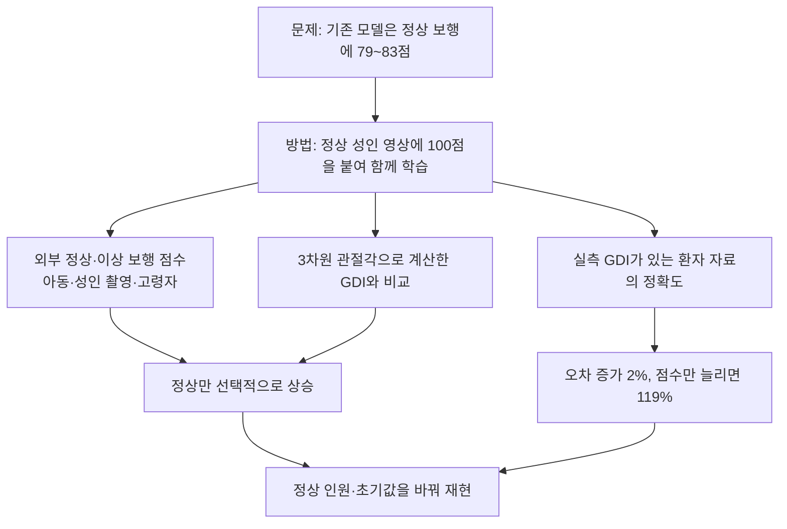
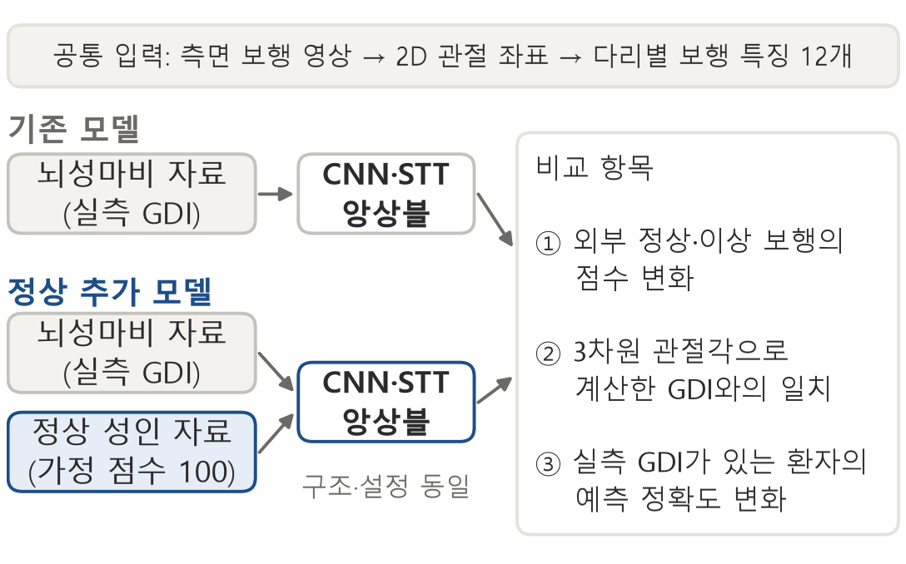
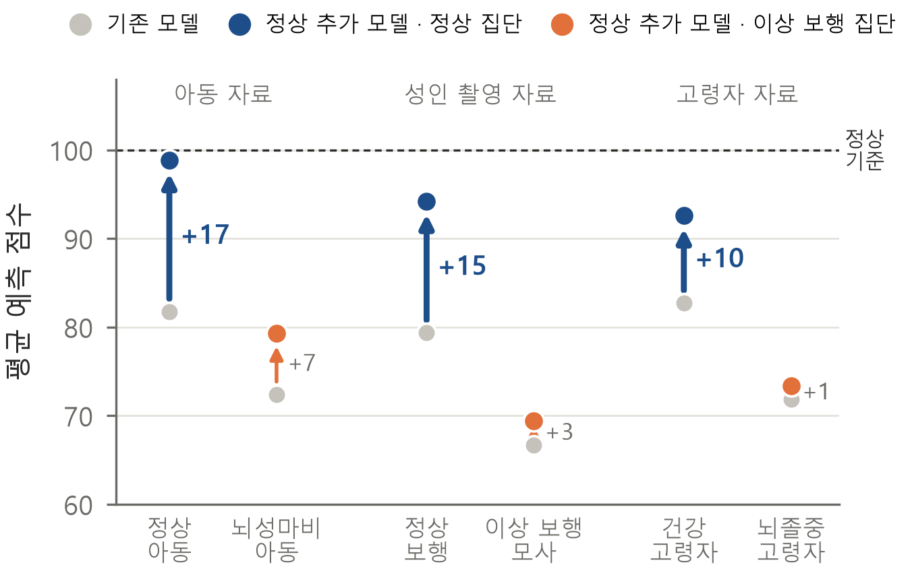
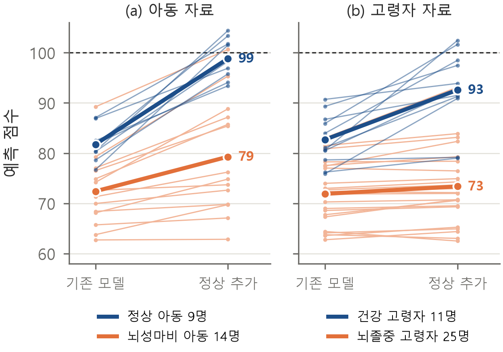
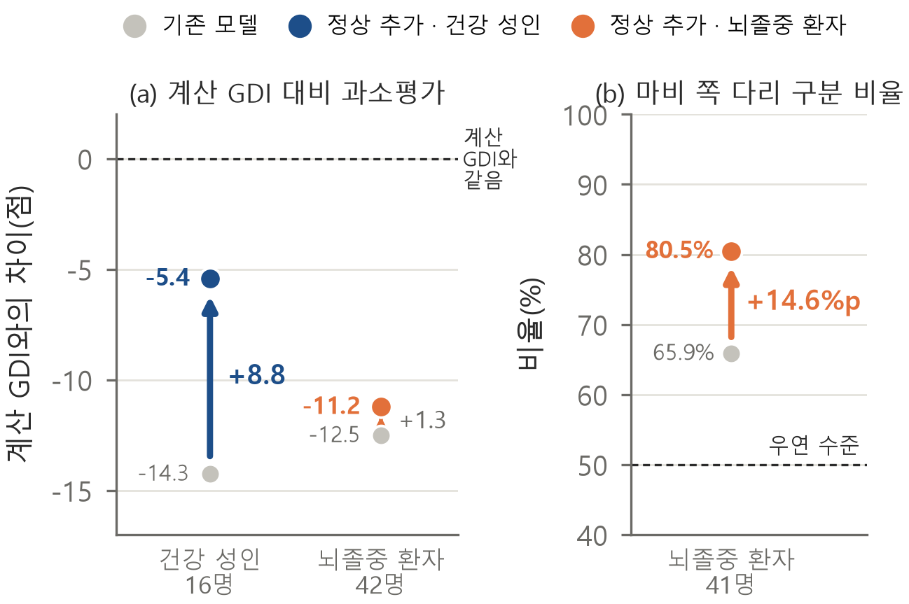

# 영상 기반 GDI 모델의 정상 보행 과소평가 개선 — 연구 흐름

2026-11-11 정리. UCWIT 논문 원고(「영상 기반 GDI 추정 모델의 정상 보행 과소평가 개선」)의 근거가 된 실험과, 같은 시기에 진행했지만 원고에 쓰지 않은 실험을 한곳에 모았다. 이 문서는 전체 흐름을 쉽게 읽기 위한 안내이고, 각 실험의 조건·코드·집계 수치는 링크한 실험 기록에 있다. 원고 자체와 원자료·사람별 결과·모델 가중치는 포함하지 않았다.

## 한 문단 요약

보행편차지수(GDI)는 보행이 정상에서 얼마나 벗어났는지를 나타내는 점수로, 정상 보행이 100점이다. 측면 영상으로 GDI를 추정하는 기존 모델은 뇌성마비 환자 자료로만 학습되어, 학습에 쓰지 않은 정상 아동·성인·고령자의 보행에도 80점 안팎을 주었다. 실측 GDI가 없는 정상 성인 64명(영상 881개)에 100점을 붙여 함께 학습하자, 정상 보행은 92.6~98.8점으로 올라가고 이상 보행은 거의 오르지 않았다. 환자 자료의 오차는 6.249점에서 6.375점으로 2% 늘었다. 학습 없이 점수만 늘리면 오차가 119% 늘어나므로, 이 개선은 학습에서 나온 것이다.

## 연구 흐름

## 사용한 자료

| 자료 | 사용한 내용 | 규모 | 용도 |
| --- | --- | --- | --- |
| 뇌성마비 자료(Kidziński 등) 학습용 | 측면 영상의 2D 관절 좌표와 실측 GDI | 692명, 영상 1,061개 | 학습 |
| 뇌성마비 자료 평가용 | 처음부터 분리, 학습에 쓰지 않음 | 222명, 영상 377개 | 정확도 평가 |
| 정상 성인 자료(LJMU) | 정상 성인 측면 영상 | 64명, 영상 881개 | 학습(가정 점수 100) |
| 아동 자료(LIVE-GaitNeuroKids) | 정상 아동·뇌성마비 아동 측면 영상 | 9명·14명 | 외부 검증 |
| 성인 촬영 자료(직접 촬영) | 성인 3명의 정상 보행·이상 보행 모사 | 영상 6개·7개 | 외부 검증 |
| 고령자 자료(Van Criekinge 등) | 건강 성인·뇌졸중 환자의 3차원 표지점과 관절각 | 16명·42명(점수 비교는 65세 이상 11명·25명) | 외부 검증, GDI 계산 |

외부 자료에는 실측 GDI가 없다. 고령자 자료는 실제 영상이 아니라 3차원 표지점을 측면 2D 좌표로 바꾼 입력이다.

## 단계별 결과

### 1. 기존 모델의 기준 성능

평가용 환자 자료를 열기 전에 모델 구조와 앙상블 비율을 학습용 자료의 내부 검증으로 정해 고정했고, 그 뒤 한 번 평가했다. CNN·STT 앙상블의 MAE는 6.249점, 상관계수는 0.768이었다. 기록: [평가용 자료 고정 평가](../archive/gdi-research-harness/studies/20261102-final223-frozen/README.md)

### 2. 정상 성인을 100점으로 추가해 학습

같은 구조·설정에 정상 성인 자료만 더해 다시 학습했다. 가정 점수는 측정값이 아니므로, 출력을 GDI 점수 척도에 맞추는 선형 보정은 학습용 환자 자료의 실측 GDI만으로 정했다. 기록: [정상 추가 학습](../archive/studies/20261104-ljmu100-mixed/README.md), [실측 GDI만으로 보정](../archive/studies/20261105-unseen-normal-test/stanford-calibration/README.md), [모델 배포](normal100-models/README.md)

### 3. 처음 보는 정상 보행은 올라가고, 이상 보행은 거의 그대로다

| 자료 | 정상 집단 (기존 → 정상 추가) | 이상 보행 집단 (기존 → 정상 추가) | 상승 폭 차이 (95% 구간) |
| --- | --- | --- | --- |
| 아동 자료 | 81.8 → 98.8 | 뇌성마비 72.4 → 79.3 | 10.2 (5.9~14.5) |
| 성인 촬영 자료 | 79.4 → 94.2 | 이상 보행 모사 66.7 → 69.5 | 12.1 (9.1~14.8) |
| 고령자 자료 | 82.7 → 92.6 | 뇌졸중 71.9 → 73.4 | 8.4 (4.5~12.3) |

세 자료 모두 정상 집단이 더 많이 올랐다. 각 자료 안에서 두 집단은 같은 환경에서 촬영되었으므로 촬영 조건 차이로는 설명되지 않는다. 아동 자료에서 같은 5~10세 뇌성마비 아동 8명으로 한정해도 차이(8.2점)가 유지되었다.

기록: [아동 자료](../archive/studies/20261107-live-patient-eval/README.md), [성인 촬영·정상 성인](../archive/studies/20261105-unseen-normal-test/README.md), [고령자 자료](../archive/studies/20261106-older-normal100/README.md), [통계 보강](../archive/studies/20261110-external-stats/README.md)

### 4. 3차원 관절각으로 직접 계산한 GDI와 비교

외부 자료에는 실측 GDI가 없어 점수가 맞는 방향인지 직접 확인할 수 없다. 고령자 자료에는 3차원 관절각이 있으므로, 원 논문의 공식(9개 관절각 곡선 → 459개 숫자 → 대표 패턴 15개 → 건강 성인 평균과의 거리 → 100점 척도)으로 GDI를 직접 계산했다(계산 GDI). 188명의 걸음 2,437개를 썼고, 대표 패턴 15개가 차이의 98.6%를 설명해 원 논문과 같은 구조를 보였다.

- 건강 성인의 과소평가가 −14.3점에서 −5.4점으로 줄었고, 계산 GDI와의 평균 절대 차이도 13.1점에서 11.0점으로 줄었다.
- 사람들 사이의 순위(상관계수 0.78 → 0.74)는 유지되었다.
- 학습하지 않은 뇌졸중 환자 41명 중 마비 쪽 다리를 반대쪽보다 낮게 평가한 비율이 65.9%에서 80.5%로 높아졌다.

계산 GDI의 기준 집단은 이 자료의 건강 성인이고, 모델은 아동 정상 기준으로 학습되었으므로 두 점수의 척도는 처음부터 조금 다르다. 기록: [계산 GDI 비교](../archive/studies/20261110-recomputed-gdi/README.md), [마비 쪽 다리 구분](../archive/studies/20261110-paretic-leg/README.md)

### 5. 환자 정확도는 거의 유지된다 — 점수만 늘리는 것과 비교

| 모델 | 평가용 MAE | 상관계수 | 정상 아동 | 뇌성마비 아동 | 뇌졸중 고령자 |
| --- | --- | --- | --- | --- | --- |
| 기존 모델 | 6.249 | 0.768 | 81.8 | 72.4 | 71.9 |
| 기존 모델 + 점수 재조정 | 13.714 | 0.768 | 98.8 | 81.3 | 80.4 |
| 정상 추가 모델 | 6.375 | 0.757 | 98.8 | 79.3 | 73.4 |

점수 재조정은 학습 없이 기존 점수에 선형 변환(× 1.87 − 54.3)을 적용해 정상 아동을 98.8점에 맞춘 대조 조건이다. 정상 아동을 맞추는 선형 변환 가운데 학습용 환자 자료의 오차가 가장 작은 것을 골랐는데도, 환자 점수까지 함께 부풀어 오차가 119% 늘었다. 기록: [평가용 자료 비교](../archive/studies/20261106-final222-normal100/README.md), [점수 재조정 대조](../archive/studies/20261110-rescale-control/README.md)

### 6. 정상 인원과 학습 초기값을 바꿔도 같은 결과

| 정상 성인 (영상) | 0 | 4 (62) | 8 (121) | 16 (233) | 32 (450) | 64 (881) |
| --- | --- | --- | --- | --- | --- | --- |
| 정상 아동 점수 | 81.8 | 91.8 | 94.5 | 96.6 | 98.3 | 98.8 |
| 평가용 MAE | 6.249 | 6.312 | 6.317 | 6.342 | 6.355 | 6.375 |

정상 점수는 인원이 늘수록 한 번도 빠짐없이 올랐고, 처음 4~8명에서 대부분 올랐다. 8명에서는 오차 증가(+0.068점)의 95% 구간이 0을 포함했다. 학습 초기값을 세 가지로 바꿔도 정상 아동 상승(16.7~18.2점), 정상−이상 차이 증가, 오차 증가(0.08~0.13점)의 방향이 모두 같았다. 체크포인트 600개의 지문과 재예측을 검산했다. 기록: [정상 인원·초기값](../archive/studies/20261110-dose-seed/README.md)

## 원고에 쓰지 않은 실험

| 실험 | 질문 | 결과 | 기록 |
| --- | --- | --- | --- |
| 모델 개선 시도 | 순위 학습·출처 구분 방지·보행 주기 맞춤으로 고득점 과소예측을 줄일 수 있는가 | 네 방법 모두 줄이지 못했고 정확도 기준도 넘지 못함 | [모델 개선](../archive/studies/20261109-model-improvement/README.md) |
| 짧은 추가 학습 | 기존 모델에서 출발해 짧게 더 학습하면 오차 증가를 줄일 수 있는가 | 정상 점수는 회복했으나 오차 증가(+0.231)가 처음부터 학습(+0.126)보다 큼 | [짧은 추가 학습](../archive/studies/20261110-finetune/README.md) |
| 기준점 하나로 구분 | 90점 기준점 하나로 정상·이상을 나눌 수 있는가 | 정상 추가 모델은 균형 정확도 0.91이었지만, 기존 모델도 약 75점 기준으로 옮겨 쓰면 비슷하게 구분되어 장점으로 주장하지 않음 | [기준점 분석](../archive/studies/20261110-single-threshold/README.md) |
| 소량 추가 | 정상 성인 9명·영상 12개만 추가하면 | 오차는 같았으나 정상 점수 상승은 2~5점. 설계가 달라 정상 인원별 학습으로 대체 | [학습](../archive/studies/20261105-matched-normal100/README.md), [평가](../archive/studies/20261107-dose222/README.md) |

## 한계

- 외부 자료에는 실측 GDI가 없고 표본이 작다(정상 아동 9명, 성인 촬영 3명).
- 고령자 자료는 실제 영상이 아니라 3차원 표지점을 변환한 입력이다.
- 계산 GDI는 원래 GDI와 기준 집단이 달라 척도가 같다고 보장할 수 없다.
- 실측 GDI가 매우 높은 다리를 낮게 예측하는 경향은 두 모델 모두에 남아 있다.

## 공개 범위

실험 기록은 [전체 실험 보관](../archive/README.md)과 같은 규칙으로 공개용 사본을 만들었다. 서버 주소·계정을 가리고, 사람별 정답·예측·목록 항목과 원자료·체크포인트·출처 이용 조건이 불분명한 STT 원본 코드는 제외했다. 따라서 공개 사본만으로 다시 실행되지는 않는다.
