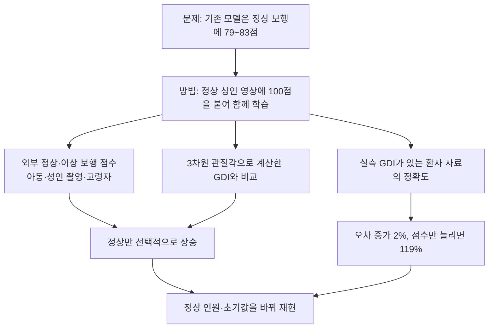
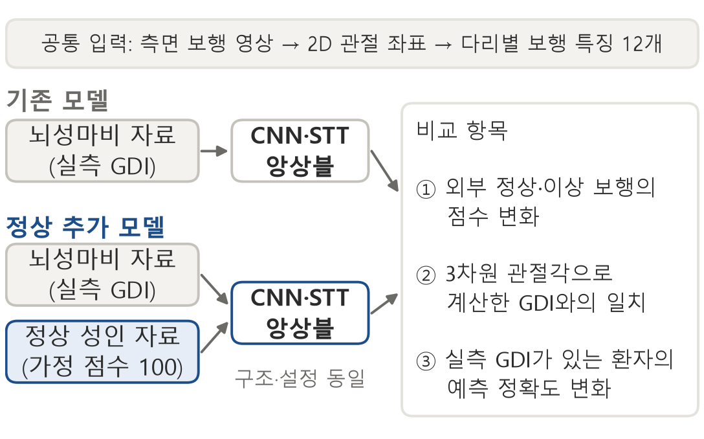
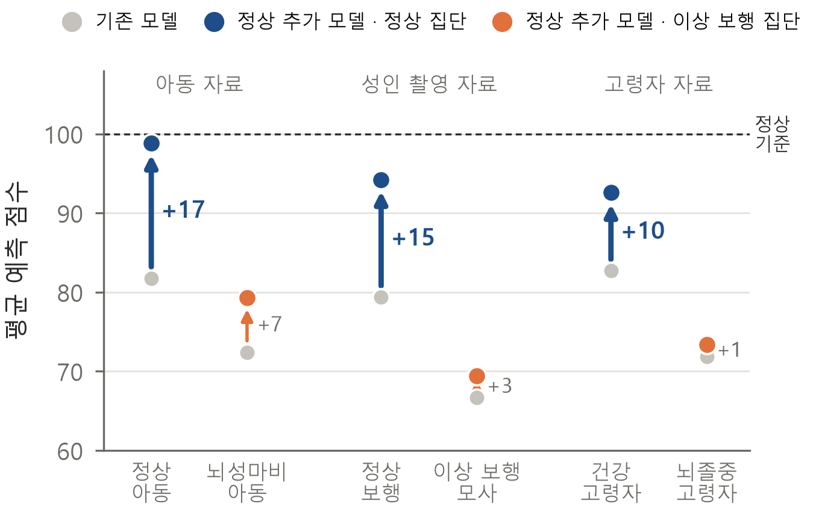
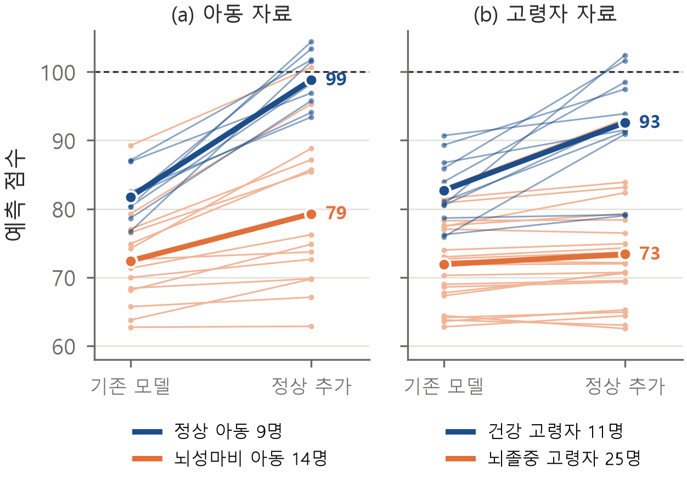
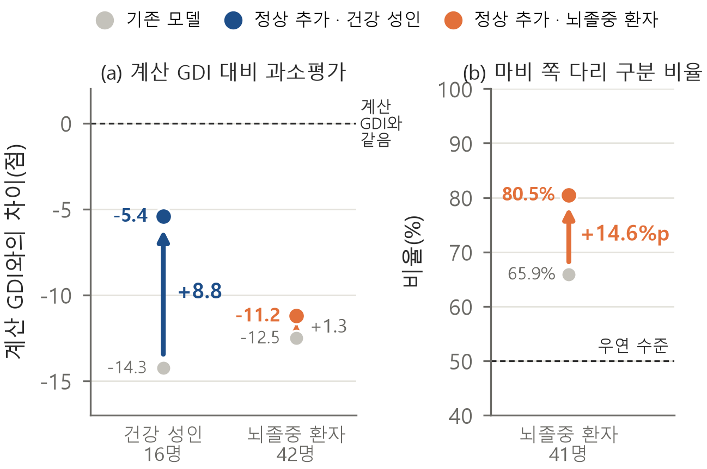

# 영상 기반 GDI 모델의 정상 보행 과소평가 개선 — 연구 흐름

[논문 실험 요약](README.md)

## 한 문단 요약

측면 영상으로 보행 편차 지수(GDI)를 추정하는 기존 모델은 학습에 쓰지 않은 정상 집단에 평균 79.4~82.7점을 냈습니다. 실측 GDI가 없는 정상 성인 64명·881편에 100점을 가정해 함께 학습하자, 외부 정상 집단의 평균 출력이 92.6~98.8점으로 올랐습니다. 비교한 세 자료에서 이상 보행 집단의 상승 폭은 더 작았습니다. 실측 GDI가 있는 별도 환자 222명에서는 평균 절대오차가 6.249점에서 6.375점으로 늘었고, 학습 없이 기존 점수만 재조정한 대조에서는 13.714점이었습니다.

## 연구 흐름

## 사용한 자료

| 자료 | 사용한 내용 | 규모 | 용도 |
| --- | --- | --- | --- |
| 뇌성마비 자료(Kidziński 등) 학습용 | 측면 영상의 2D 관절 좌표와 실측 GDI | 692명, 영상 1,061개 | 학습 |
| 뇌성마비 자료 평가용 | 처음부터 분리, 학습에 쓰지 않음 | 222명, 영상 377개 | 정확도 평가 |
| 정상 성인 자료(LJMU) | 정상 성인 측면 영상 | 64명, 영상 881개 | 학습(가정 점수 100) |
| 아동 자료(LIVE-GaitNeuroKids) | 정상 아동·뇌성마비 아동 측면 영상 | 9명·14명 | 외부 검증 |
| 성인 촬영 자료(직접 촬영) | 성인 3명의 정상 보행·이상 보행 모사 | 영상 6개·7개 | 외부 검증 |
| 고령자 자료(Van Criekinge 등) | 건강 성인·뇌졸중 환자의 3차원 표지점과 관절각 | 16명·42명(점수 비교는 65세 이상 11명·25명) | 외부 검증, GDI 계산 |

외부 자료에는 실측 GDI가 없다. 고령자 자료는 실제 영상이 아니라 3차원 표지점을 측면 2D 좌표로 바꾼 입력이다.

## 단계별 결과

### 1. 기존 모델의 기준 성능

평가용 환자 자료를 열기 전에 모델 구조와 앙상블 비율을 학습용 자료의 내부 검증으로 정해 고정했고, 그 뒤 한 번 평가했다. CNN·STT 앙상블의 MAE는 6.249점, 상관계수는 0.768이었다. 기록: [평가용 자료 고정 평가](../archive/gdi-research-harness/studies/20261102-final223-frozen/README.md)

### 2. 정상 성인을 100점으로 추가해 학습

같은 구조·설정에 정상 성인 자료만 더해 다시 학습했다. 가정 점수는 측정값이 아니므로, 출력을 GDI 점수 척도에 맞추는 선형 보정은 학습용 환자 자료의 실측 GDI만으로 정했다. 기록: [정상 추가 학습](../archive/studies/20261104-ljmu100-mixed/README.md), [실측 GDI만으로 보정](../archive/studies/20261105-unseen-normal-test/stanford-calibration/README.md), [모델 배포](normal100-models/README.md)

### 3. 외부 정상 집단과 이상 보행 집단의 점수 변화

| 자료 | 정상 집단 (기존 → 정상 추가) | 이상 보행 집단 (기존 → 정상 추가) | 상승 폭 차이 (95% 구간) |
| --- | --- | --- | --- |
| 아동 자료 | 81.8 → 98.8 | 뇌성마비 72.4 → 79.3 | 10.2 (5.9~14.5) |
| 성인 촬영 자료 | 79.4 → 94.2 | 이상 보행 모사 66.7 → 69.5 | 12.1 (9.1~14.8) |
| 고령자 자료 | 82.7 → 92.6 | 뇌졸중 71.9 → 73.4 | 8.4 (4.5~12.3) |

세 자료 모두 정상 집단이 더 많이 올랐다. 같은 자료 안의 집단을 비교해 자료 간 촬영 조건 차이의 영향을 줄였다. 아동 자료에서 같은 5~10세 뇌성마비 아동 8명으로 한정해도 차이(8.2점)가 유지되었다.

기록: [아동 자료](../archive/studies/20261107-live-patient-eval/README.md), [성인 촬영·정상 성인](../archive/studies/20261105-unseen-normal-test/README.md), [고령자 자료](../archive/studies/20261106-older-normal100/README.md), [통계 보강](../archive/studies/20261110-external-stats/README.md)

### 4. 3차원 관절각으로 직접 계산한 GDI와 비교

외부 자료에는 실측 GDI가 없어 점수가 맞는 방향인지 직접 확인할 수 없다. 고령자 자료에는 3차원 관절각이 있으므로, 원 논문의 공식(9개 관절각 곡선 → 459개 숫자 → 대표 패턴 15개 → 건강 성인 평균과의 거리 → 100점 척도)으로 GDI를 직접 계산했다(계산 GDI). 188명의 걸음 2,437개를 썼고, 대표 패턴 15개가 차이의 98.6%를 설명해 원 논문과 같은 구조를 보였다.

- 건강 성인의 과소평가가 −14.3점에서 −5.4점으로 줄었고, 계산 GDI와의 평균 절대 차이도 13.1점에서 11.0점으로 줄었다.
- 계산 GDI와 모델 점수 사이의 상관계수는 0.78에서 0.74로 낮아졌다.
- 학습하지 않은 뇌졸중 환자 41명 중 마비 쪽 다리를 반대쪽보다 낮게 평가한 비율이 65.9%에서 80.5%로 높아졌다.

계산 GDI의 기준 집단은 이 자료의 건강 성인이고, 모델은 아동 정상 기준으로 학습되었으므로 두 점수의 척도는 처음부터 조금 다르다. 기록: [계산 GDI 비교](../archive/studies/20261110-recomputed-gdi/README.md), [마비 쪽 다리 구분](../archive/studies/20261110-paretic-leg/README.md)

### 5. 환자 자료의 오차와 점수 재조정 대조

| 모델 | 평가용 MAE | 상관계수 | 정상 아동 | 뇌성마비 아동 | 뇌졸중 고령자 |
| --- | --- | --- | --- | --- | --- |
| 기존 모델 | 6.249 | 0.768 | 81.8 | 72.4 | 71.9 |
| 기존 모델 + 점수 재조정 | 13.714 | 0.768 | 98.8 | 81.3 | 80.4 |
| 정상 추가 모델 | 6.375 | 0.757 | 98.8 | 79.3 | 73.4 |

점수 재조정은 학습 없이 기존 점수에 선형 변환(× 1.87 − 54.3)을 적용해 정상 아동을 98.8점에 맞춘 대조 조건이다. 정상 아동을 맞추는 선형 변환 가운데 학습용 환자 자료의 오차가 가장 작은 것을 골랐는데도, 환자 점수까지 함께 부풀어 오차가 119% 늘었다. 기록: [평가용 자료 비교](../archive/studies/20261106-final222-normal100/README.md), [점수 재조정 대조](../archive/studies/20261110-rescale-control/README.md)

### 6. 후속 분석에서 정상 인원과 학습 초기값을 바꿔 비교

| 정상 성인 (영상) | 0 | 4 (62) | 8 (121) | 16 (233) | 32 (450) | 64 (881) |
| --- | --- | --- | --- | --- | --- | --- |
| 정상 아동 점수 | 81.8 | 91.8 | 94.5 | 96.6 | 98.3 | 98.8 |
| 평가용 MAE | 6.249 | 6.312 | 6.317 | 6.342 | 6.355 | 6.375 |

정상 점수는 인원이 늘수록 한 번도 빠짐없이 올랐고, 처음 4~8명에서 대부분 올랐다. 8명에서는 오차 증가(+0.068점)의 95% 구간이 0을 포함했다. 학습 난수를 세 가지로 바꿔도 정상 아동 상승(16.7~18.2점), 정상−이상 차이 증가, 오차 증가(0.08~0.13점)의 방향이 모두 같았다. 체크포인트 600개의 지문과 재예측을 검산했다. 기록: [정상 인원·초기값](../archive/studies/20261110-dose-seed/README.md)

## 결과를 적용할 때 확인할 점

- 정상 자료를 추가하고 Stanford 학습자료만으로 보정했을 때, 개발자료의 평균 절대오차는 6.516점에서 6.655점으로 늘었습니다. 별도로 분리한 환자 222명의 결과와 평가 집단이 다릅니다. [개발자료 보정 비교](../archive/studies/20261105-unseen-normal-test/stanford-calibration/README.md)
- 초기 CNN·STT 실험에서는 보행의 정상성을 직접 학습하지 않고 자료 출처를 구분하는 방법도 외부 정상 아동에게 높은 점수를 냈습니다. 점수가 올라간 것만으로 모델이 어떤 움직임을 학습했는지 알기 어려워, 같은 자료의 정상·이상 보행 비교와 계산 GDI 대조를 함께 봐야 합니다. [출처 대조](../archive/studies/20261105-normal-transfer-followup/README.md)
- 정상·이상을 나누는 기준점을 모델별로 조정하면 기존 모델도 비슷한 구분 성능을 보였습니다. 집단 평균의 점수 간격은 넓어졌지만, 실사용에서 판정 기준을 정하려면 별도 자료가 필요합니다. [기준점 비교](../archive/studies/20261110-single-threshold/README.md)

## 한계

- 외부 자료에는 실측 GDI가 없고 표본이 작다(정상 아동 9명, 성인 촬영 3명).
- 고령자 자료는 실제 영상이 아니라 3차원 표지점을 변환한 입력이다.
- 계산 GDI는 원래 GDI와 기준 집단이 달라 척도가 같다고 보장할 수 없다.
- 실측 GDI가 매우 높은 다리를 낮게 예측하는 경향은 두 모델 모두에 남아 있다.

## 공개 범위

실험 기록은 [전체 실험 보관](../archive/README.md)과 같은 규칙으로 공개용 사본을 만들었다. 서버 주소·계정을 가리고, 사람별 정답·예측·목록 항목과 원자료·체크포인트·출처 이용 조건이 불분명한 STT 원본 코드는 제외했다. 따라서 공개 사본만으로 다시 실행되지는 않는다.
